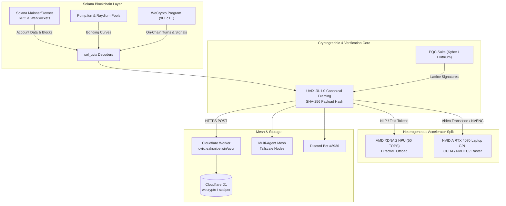

# UVIX-SOL: Post-Quantum Cryptography, Solana On-Chain Verification & UVIX-RI-1.0 Mesh

[](https://solana.com)
[](https://wecrytpo.app.leaksnipe.idl.win)
[-black)](PQC_SECURITY.md)
[](https://uvix.leaksnipe.win/uvix)
[](#5-hardware-workload-split-npu--gpu)
[](https://opensource.org/licenses/MIT)

UVIX-SOL provides the unified Solana on-chain anchoring layer, post-quantum cryptographic (PQC) validation pipeline, and zero-trust multi-agent telemetry protocol for the **LeakSnipe / WeCrypto** estate. It combines on-chain Proof-of-History state commits, calibrated predictive market settlement with Brier scoring, token forensic verification, lattice-based cryptographic signing, and heterogeneous hardware offloading.

---

## 1. Solana On-Chain Program: `WeCrypto`

* **Program ID**: `9HLcTyxqXTimBXj9RvP2dZtTwZsNdzdiGRNRdUTTUp5B`
* **Canonical IDL**: [`idl/wecrypto.json`](idl/wecrypto.json) and [`solana/wecrypto/app/idl/wecrypto.json`](solana/wecrypto/app/idl/wecrypto.json)
* **Hosted IDL URI**: `https://wecrytpo.app.leaksnipe.idl.win/idl/wecrypto.json`
* **Framework**: Anchor `1.2.1` / Agave SDK `v3.1+` / Rust `1.89+`

### Instructions

| Instruction | Accounts & Discriminator | Purpose |
| :--- | :--- | :--- |
| `initialize` | `[payer, config, system_program]` | Initializes the singleton `GlobalConfig` PDA with admin authority and canonical IDL endpoint. |
| `record_turn_proof` | `[payer, config, turn_anchor, system_program]` | Commits a strictly monotonic state turn hash (`[u8; 32]`) anchored to Cloudflare D1 proof turns and Solana slot height. |
| `commit_prediction` | `[payer, config, commitment, system_program]` | Cryptographically commits market probability forecasts (touch/settle basis points) before expiration horizons. |
| `resolve_prediction` | `[authority, config, commitment]` | Records realized market settlement outcomes, settlement price, and quadratic Brier score loss. |
| `log_token_signal` | `[payer, config, signal_record, system_program]` | Stores on-chain forensic assessment (risk score, LP burn/lock status, bundle cluster detection, metadata hash). |
| `update_config` | `[authority, config]` | Administrative pause controls, authority migration, and IDL URI updates. |

### Program Derived Addresses (PDAs)

```rust
// Global configuration singleton
[b"global_config"]

// Proof-of-History turn state commits
[b"poh_turn", sequence.to_le_bytes().as_ref()]

// Horizon prediction commitments
[b"prediction", sequence.to_le_bytes().as_ref()]

// Token security & rugcheck forensics
[b"token_signal", token_mint.as_ref()]
```

---

## 2. SOL-UVIX Interoperability Protocol Suite (`UVIX-RI-1.0`)

Enables deterministic, zero-trust telemetry streaming and cross-agent execution across **Solana RPCs**, **Pump.fun bonding curves**, **Raydium AMMs**, **Cloudflare Workers**, **Discord bots**, and real-time **Parallel CFR game-theoretic solvers**.

### Key Modules (`sol_uvix/`)

- **UVIX-RI-1.0 Envelope Framing**: Canonical `UVIX::<base64>::END` formatting with deterministic sorted-key SHA-256 payload integrity hashing (`payload_hash`).
- **Solana On-Chain Decoders**:
  - **Versioned Transactions (v0 & Legacy)**: Wire-level deserialization, Address Lookup Table (ALT) address resolution, instruction permission mapping (signer/writable), and ComputeBudget priority fee extraction.
  - **Address Lookup Table (ALT) Accounts**: Decoding `AddressLookupTab1e1111111111111111111111111` binary accounts, extracting authorities, and indexing dynamically resolved addresses.
  - **Pump.fun Bonding Curves** (`6EF8rrecthR5Dkzon8Nwu78hRvfCKubJ14M5uBEwF6P`): Binary account decoding, virtual reserve ratios, SOL pricing, migration tracking, and constant-product swap simulations (`simulate_buy`, `simulate_sell`).
  - **Raydium V4 AMM Pools** (`675kPX9MHTjS2zt1qfr1NYHuzeLXfQM9H24wFSUt1Mp8`): Constant-product pool reserves, depth calculations, price updates, and swap simulations (`simulate_swap`).
  - **SPL Token & Token-2022**: Base 82-byte mint and 165-byte account layout decoding, TLV extension support (`TransferFeeConfig`, `TransferFeeAmount`, `InterestBearingConfig`, `TokenMetadata`, `MetadataPointer`), and epoch-based fee math.
- **Edge-Ready Cloudflare Worker**: Built-in edge handler (`uvix.leaksnipe.win/uvix`) that verifies payload integrity hashes in V8 and streams telemetry into Cloudflare D1 (`wecrypto`, `scalper`).
- **Multi-Agent Coordination & Mesh Handoffs**: Standardized payloads for inter-agent context handoffs across Tailscale mesh nodes.

---

## 3. Architecture & Data Flow



---

## 4. Directory Structure

```
UVIX-SOL/
├── idl/
│   └── wecrypto.json           # Canonical Anchor IDL with metadata origin
├── solana/
│   └── wecrypto/               # Complete Anchor Rust program suite
│       ├── programs/wecrypto/  # Program source (instructions, state, error, constants)
│       ├── tests/              # LiteSVM automated unit/integration tests
│       ├── Anchor.toml         # Anchor configuration pointing to 9HLcTyxq...
│       └── Cargo.toml          # Workspace manifest
├── sol_uvix/                   # Core Python Protocol SDK & Hardware Engines
│   ├── codec.py                # UVIX-RI-1.0 canonical framing & SHA-256 hashing
│   ├── transactions.py         # VersionedTx (v0), Legacy, ALTs, ComputeBudget
│   ├── tokens.py               # SPL Token & Token-2022 TLV extension unpacking
│   ├── pumpfun.py              # Pump.fun bonding curve decoder & math
│   ├── raydium.py              # Raydium V4 AMM pool decoder & swap math
│   ├── ws_client.py            # PubSub WebSocket client
│   ├── bridge.py               # Cloudflare Edge bridge client
│   ├── npu_engine.py           # DirectML AMD XDNA 2 NPU text offload engine
│   ├── gpu_pipeline.py         # NVIDIA RTX 4070 NVENC/CUDA raster pipeline
│   └── hardware_orchestrator.py # Dynamic workload dispatcher
├── edge/
│   └── worker.ts               # Cloudflare Worker edge router & D1 binding
├── scripts/
│   └── setup_npu_gpu_split.ps1 # Hardware split configuration script
├── tests/                      # Automated test suite (30 pytest tests)
├── .cursor/
│   ├── rules/solana-mcp.mdc    # Cursor project rule for Solana Developer MCP
│   └── mcp.json                # Project-level MCP config (mcp.solana.com)
├── pqc.py                      # Post-quantum cryptographic algorithms (Kyber/Dilithium)
├── pqc_api.py                  # PQC REST API & verification routes
├── pqc_files.py                # Encrypted key storage and payload packaging
├── ai_processor.py             # Neural strategy & feature generation
├── ai_router.py                # Model inference routing & fallback
├── dossier_manager.py          # Opponent intelligence and state profiling
├── equity_sim.py               # Monte Carlo game tree simulation
├── nash_train.py               # CFR+ Nash equilibrium solver
├── poker_engine.py             # Real-time state evaluation engine
└── server.py                   # Local orchestration daemon
```

---

## 5. Hardware Workload Split (NPU + GPU)

| Subsystem | Target Processor | Hardware Specs & Driver | Assigned Workload | Protocol Slug Layer |
| :--- | :--- | :--- | :--- | :--- |
| **Text Off-Ramping** | **AMD Ryzen AI 9 HX 370 (NPU)** | AMD XDNA 2 NPU (50 TOPS)<br>`IpuMcdmDriver` (MCDDM) | Text parsing, LLM token generation, state embeddings | `npu-text-v1` (`UVIX-RI-1.0`) |
| **Video Transcoding** | **NVIDIA RTX 4070 Laptop GPU** | 8 GB GDDR6 VRAM<br>NVENC / NVDEC (`616.92`) | Hardware HEVC/H.264 video encode/decode streams | `gpu-video-raster-v1` (`UVIX-RI-1.0`) |
| **Raster Rendering** | **NVIDIA RTX 4070 Laptop GPU** | Ada Lovelace CUDA Cores<br>Direct3D12 / Vulkan / CUDA | High-throughput primitive rasterization & graphics | `gpu-video-raster-v1` (`UVIX-RI-1.0`) |

---

## 6. Development & Testing

### Solana Program Build & LiteSVM Tests
```bash
cd solana/wecrypto
anchor build
cargo test --package wecrypto
```

### Python Protocol & Hardware Test Suite
```bash
py -3.13 -m pytest -v
```

---

## 7. Repositories & Synchronized Remotes

- **GitHub**: [`https://github.com/JohnDaWalka/UVIX-SOL`](https://github.com/JohnDaWalka/UVIX-SOL)
- **GitLab**: [`https://gitlab.com/maurofanellijr/SOL-UVIX`](https://gitlab.com/maurofanellijr/SOL-UVIX)

---

## 8. License

MIT © [JohnDaWalka](https://github.com/johndawalka) & [Mauro Fanelli](mailto:maurofanellijr@gmail.com).
