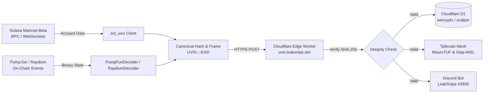

# SOL-UVIX: Solana Stack & UVIX-RI-1.0 Interoperability Protocol

[](https://github.com/johndawalka/SOL-UVIX/actions)
[](https://opensource.org/licenses/MIT)
[](https://uvix.leaksnipe.win/uvix)

High-performance cryptographic bridge, SDK, and edge runtime for encapsulating the Solana blockchain stack into the canonical **UVIX Slug Protocol (`UVIX-RI-1.0`)**.

Enables deterministic, zero-trust telemetry streaming and cross-agent execution across **Solana RPCs**, **Pump.fun bonding curves**, **Raydium AMMs**, **Cloudflare Workers**, **Discord bots**, and real-time **Parallel CFR game-theoretic solvers**.

---

## 🌟 Key Features

- **UVIX-RI-1.0 Envelope Framing**: Canonical `UVIX::<base64>::END` formatting with deterministic SHA-256 payload integrity hashing (`payload_hash`).
- **Solana On-Chain Decoders**:
  - **Pump.fun Bonding Curves** (`6EF8rrecthR5Dkzon8Nwu78hRvfCKubJ14M5uBEwF6P`): Binary account decoding, virtual reserve ratios, SOL pricing, and migration progress tracking.
  - **Raydium V4 AMM Pools** (`675kPX9MHTjS2zt1qfr1NYHuzeLXfQM9H24wFSUt1Mp8`): Constant-product pool reserves, depth calculations, and price updates.
  - **SPL Token & Token-2022**: Balance extraction, ownership tracking, and mint telemetry.
- **Edge-Ready Cloudflare Worker**: Built-in edge handler (`uvix.leaksnipe.win/uvix`) that verifies payload integrity hashes in V8 and streams telemetry into Cloudflare D1 (`wecrypto`, `scalper`).
- **Multi-Agent Coordination & Mesh Handoffs**: Standardized payloads for inter-agent context handoffs across Tailscale mesh nodes (`maurotufgamingp`, `glap_wsl`, `mariphone`).
- **Polyglot Verification**: Dual Python 3.10+ and Node.js/TypeScript implementations ensuring strict 1:1 cross-language deterministic JSON sorting and SHA-256 validation.

---

## 📐 Architecture & Flow



---

## 📦 Installation

### Python
```bash
git clone https://github.com/johndawalka/SOL-UVIX.git
cd SOL-UVIX
pip install -e .
```

### Node.js / Edge Worker
```bash
npm install
npm test
```

---

## 🚀 Quickstart

### 1. Encode a Solana State into a UVIX Slug

```python
from sol_uvix import encode_uvix_slug

payload = {
    "mint": "DezXAZ8z7PnrnRJjz3wXBoRgixCa6xjnB7YaB1pPB263",
    "symbol": "BONK",
    "sol_price": 0.000000021,
    "slot": 284910283
}

# Generates canonical UVIX::<base64>::END envelope with SHA-256 integrity hash
envelope = encode_uvix_slug(
    payload,
    source_platform="Solana-Mainnet",
    target_platform="UVIX-Mesh-MultiAgent"
)

print(envelope)
# Output: UVIX::eyJjb21wYXRpYmlsaXR5X2xheWVyIjoic29sYW5hLXV2aXgtdjEiLC...::END
```

### 2. Decode and Verify Slug Integrity

```python
from sol_uvix import decode_uvix_slug, UVIXIntegrityError

try:
    slug = decode_uvix_slug(envelope, verify_integrity=True)
    print("Source:", slug.source_platform)
    print("Payload Hash:", slug.payload_hash)
    print("Data:", slug.raw_payload)
except UVIXIntegrityError as e:
    print("Tampered envelope detected!", e)
```

### 3. Pump.fun Bonding Curve Decoding

```python
from sol_uvix import PumpFunDecoder

# Decode raw account bytes directly from getAccountInfo RPC
curve_state = PumpFunDecoder.decode_account_data(
    raw_account_bytes,
    mint="6EF8rrecthR5Dkzon8Nwu78hRvfCKubJ14M5uBEwF6P"
)

print(f"Price: {curve_state.price_in_sol:.9f} SOL")
print(f"Progress to Raydium: {curve_state.progress_percent}%")

# Wrap directly to UVIX slug for multi-agent dispatch
slug = PumpFunDecoder.to_uvix_slug(curve_state)
```

---

## 🌐 CLI Usage

```bash
# Query an on-chain account and output its canonical UVIX slug
sol-uvix account DezXAZ8z7PnrnRJjz3wXBoRgixCa6xjnB7YaB1pPB263

# Decode an envelope from stdin
sol-uvix decode "UVIX::...::END"

# Encode raw JSON file
sol-uvix encode data.json --source Solana-Feeder --target MultiAgent-Mesh
```

---

## 🛡️ Protocol Specification (`UVIX-RI-1.0`)

An envelope is framed as:
```text
UVIX::<BASE64(CanonicalJSON(UVIXSlug))>::END
```

The canonical JSON object contains:
| Field | Type | Description |
|---|---|---|
| `protocol_version` | `string` | Version identifier (e.g. `"1.0"`) |
| `source_platform` | `string` | Originating subsystem (e.g. `"Solana-Stack"`) |
| `target_platform` | `string` | Destination service (e.g. `"UVIX-Mesh-MultiAgent"`) |
| `payload_hash` | `string` | SHA-256 hexadecimal hash of deterministic canonical JSON of `raw_payload` |
| `compatibility_layer`| `string` | Target protocol binding (e.g. `"solana-uvix-v1"`) |
| `raw_payload` | `object` | Arbitrary JSON payload data |

---

## 🤝 Repositories & Sync

- **GitHub**: [`https://github.com/johndawalka/SOL-UVIX`](https://github.com/johndawalka/SOL-UVIX)
- **GitLab**: [`https://gitlab.com/maurofanellijr/SOL-UVIX`](https://gitlab.com/maurofanellijr/SOL-UVIX)

---

## 📜 License

MIT © [Mauro Fanelli](mailto:maurofanellijr@gmail.com) & [JohnDaWalka](https://github.com/johndawalka).
