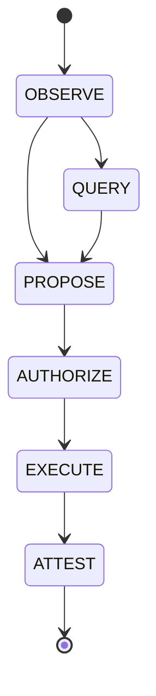

# UVIX

[](#6-the-envelope-uvix-ri-10)
[](#5-canonical-serialization-jcs)
[](#8-proof-of-history-persistence)
[](#13-the-on-chain-program)
[-black)](#12-post-quantum-core)
[](LICENSE)

**UVIX is an interoperability protocol suite for verifiable state across untrusted machines:** a deterministic wire envelope (UVIX-RI-1.0) verified identically across runtimes, an append-only Proof-of-History hash chain anchored to Solana under RFC 9162 with dual SHA-256 / BLAKE3 codecs, an authoritative entity hierarchy and slug topology, lattice-based post-quantum cryptography, and a neural routing mesh.

> **Specification Authority:** This repository's documentation and formal specifications (`spec/UVIX-RI-1.0.md`), along with the companion White Paper (*UVIX: Origin and Interoperation Without Assimilation*, 9 November 2026), constitute the specification of record. Canonical serialization follows RFC 8785 (JCS); Merkle tree hashing follows RFC 9162 (CTv2, formally upgrading and replacing obsolete RFC 6962). Every worked example in this repository recomputes byte-for-byte. If an example ever fails to recompute, the example is wrong, not the math.

What it runs on, where it runs, and who runs it are deliberately opaque: the repository ships schemas, models, proofs, and deterministic codecs — never live topologies, operational endpoints, or operator identities.

---

## Contents

- [1. Names & Naming Canon](#1-names--naming-canon)
- [2. The Compatibility Head Rule & The Six Contracts](#2-the-compatibility-head-rule--the-six-contracts)
- [3. Main Slug Topology & URI Resolution](#3-main-slug-topology--uri-resolution)
- [4. The 7-Layer Protocol Stack](#4-the-7-layer-protocol-stack)
- [5. Repository Architecture](#5-repository-architecture)
- [6. Canonical Serialization (JCS / RFC 8785)](#6-canonical-serialization-jcs--rfc-8785)
- [7. The Envelope: UVIX-RI-1.0](#7-the-envelope-uvix-ri-10)
- [8. Message Classes: Observation is Not Authority](#8-message-classes-observation-is-not-authority)
- [9. Proof-of-History Persistence & Solana Anchoring (RFC 9162)](#9-proof-of-history-persistence--solana-anchoring-rfc-9162)
- [10. Neural Mesh Routing & Loss Matrix](#10-neural-mesh-routing--loss-matrix)
- [11. Protocol Decoders](#11-protocol-decoders)
- [12. Post-Quantum Cryptographic Core](#12-post-quantum-cryptographic-core)
- [13. The On-Chain Program (WeCrypto)](#13-the-on-chain-program-wecrypto)
- [14. Cross-Chain Export (CCIP)](#14-cross-chain-export-ccip)
- [15. Funding Layer: USDC Micropayments](#15-funding-layer-usdc-micropayments)
- [16. Multi-Track Architecture](#16-multi-track-architecture)
- [17. Verification & Tests](#17-verification--tests)
- [18. Status & Decisions (D-6)](#18-status--decisions-d-6)
- [19. License & Trademarks](#19-license--trademarks)

---

## 1. Names & Naming Canon

**UVIX** is the namespace — one family's rules for naming things and packaging claims so that any program can check them byte-for-byte without trusting the sender.

$$\text{UVIX} = \textbf{Universal-Inter-Cross-Compatability}$$

The spelling **Compatability** is canonical. It is not a typographical error to be silently normalized; it is part of the identifier. UVIX admits no members and issues no credentials: a program conforms by producing and validating envelopes the canonical UVIX-RI way.

Four distinct levels live under the namespace:

| Level | Name | Definition |
| :--- | :--- | :--- |
| **Namespace** | **UVIX** | One family's rules for naming things, enforcing contracts, and packaging claims deterministically. |
| **Build Entry** | **`uvix`** | The Node build entry point the namespace grew out of. Tooling came first. |
| **Envelope** | **UVIX-RI-1.0** | The deterministic wire and envelope protocol defined under UVIX (§7). Stable in v0.1. |
| **Solana Engine** | **UVIX-SOL** | UVIX-RI-1.0 applied to Solana, persistence, cryptography, routing, and decoding. Built sequentially after the core. |

---

## 2. The Compatibility Head Rule & The Six Contracts

The foundational axiom of UVIX is **Interoperation Without Assimilation**:

> **The Compatibility Head Rule (Normative):**  
> A UVIX implementation MUST NOT require a participating system to abandon its native protocol, storage engine, runtime, or data representation in order to interoperate.  
> $$\text{Native System} \longrightarrow \text{Thin UVIX Adapter} \longrightarrow \text{Canonical Semantics}$$

Compliance is organized around **Six Independent Contracts**:

1. **Identity Contract:** Every participating entity receives a stable, location-independent `uvix:` URI. Identity is strictly distinct from instance, physical location, and transport.
2. **Capability Contract:** Systems announce discrete operations (e.g., `price.current`, `token.inspect`, `anchor.preview`) rather than forcing consumers to know private APIs beforehand. Thin adapters absorb interface differences.
3. **Envelope Contract:** All cross-boundary traffic rides UVIX-RI-1.0 slugs. Tracing, policy budgets, and evidence arrays ride as canonical payload profiles.
4. **Transport Contract:** UVIX defines no single transport. Envelopes remain semantically invariant across shared memory (SHM), Unix sockets, QUIC, HTTP, WebSocket, MCP, Tailscale, Cloudflare Workers, and private networks.
5. **State Contract:** State objects carry authoritative identifiers (`uvix:state:<namespace>:<key>`), explicit timestamps, freshness boundaries, and cryptographic provenance. UVIX defines state semantics; underlying engines define physical storage.
6. **Trust Contract:** An envelope establishes who produced it, whether bytes changed, when it was sealed, and what evidence supports it (`evidence[]` array is first-class).

---

## 3. Main Slug Topology & URI Resolution

Every participating entity receives a stable UVIX URI of the form:

$$\texttt{uvix:<domain>:<system>[:<resource>]}$$

Identities resolve exclusively through the live manifest resolver (`uvix:router:universal_mesh_v1`). An entity absent from the manifest does not resolve and MUST NOT be treated as live.

### Entity Hierarchy Slugs

| Hierarchy Slug | Canonical URI | Layer / Role | Description |
| :--- | :--- | :--- | :--- |
| `UVIX.PERSISTENCE.SOLANA_MEMO` | `uvix:persistence:solana_memo:anchor` | Persistence / Solana | Solana memo anchor preview, dual-codec verification, and broadcast transaction commitments. |
| `UVIX.DATA.D1.GOOGLE` | `uvix:data:d1:google` | Data / Cloudflare D1 | Canonical read path for historical telemetry and durable state. |
| `UVIX.DATA.D1.SCALPER` | `uvix:data:d1:scalper` | Data / Cloudflare D1 | High-frequency execution records and fill telemetry. |
| `UVIX.DATA.D1.OPPONENTS` | `uvix:data:d1:opponents` | Data / Cloudflare D1 | Opponent profiling, historical exploitability, and strategy dossiers. |
| `UVIX.DATA.D1.LEAKSNIPE` | `uvix:data:d1:leaksnipe` | Data / Cloudflare D1 | Game-theoretic leak detection and analytical telemetry. |
| `UVIX.DATA.D1.MEM` | `uvix:data:d1:mem` | Data / Cloudflare D1 | Cross-agent memory observations and work state. |
| `UVIX.DATA.D1.WECRYPTO` | `uvix:data:d1:wecrypto` | Data / Cloudflare D1 | On-chain prediction registries and turn-proof mirrors. |
| `UVIX.DATA.D1.GTO` | `uvix:data:d1:gto` | Data / Cloudflare D1 | Precomputed solver lookup tables and equity stacks. |
| `UVIX.DATA.D1.TRUFFLES` | `uvix:data:d1:truffles` | Data / Cloudflare D1 | Primary agent memory state and daily scratch observations. |
| `UVIX.DATA.ORACLE.PYTH` | `uvix:oracle:pyth` | Data / Oracle | Sub-second financial oracle price feeds. |
| `UVIX.DATA.ORACLE.DIA` | `uvix:oracle:dia` | Data / Oracle | Multi-asset decentralized oracle feeds. |
| `UVIX.DATA.ORACLE.BRTI` | `uvix:oracle:brti` | Data / Oracle | CME CF Bitcoin Real-Time Index benchmark feed. |
| `UVIX.GATEWAY` | `uvix:apex` | Gateway / MCP | Universal MCP adapter gateway routing tool invocations across frameworks. |
| `UVIX.MESH.MUSE` | `uvix:mesh:muse` | Neural Mesh | Core Linux execution node (witness, state, inference). |
| `UVIX.MESH.TUF` | `uvix:mesh:tuf` | Neural Mesh | Dual NPU/GPU hardware workstation node (AMD XDNA 2 + RTX 4070). |
| `UVIX.MESH.GLAP` | `uvix:mesh:glap` | Neural Mesh | Mobile/edge telemetry and lightweight monitoring node. |
| `UVIX.MESH.TRUFFLE` | `uvix:mesh:truffle` | Neural Mesh | Autonomous supervisor agent node. |

---

## 4. The 7-Layer Protocol Stack

UVIX semantics do not change when underlying transport or hardware changes.

```
+-------------------------------------------------------------------+
| UVIX-6: POLICY     -- Authorization, latency budgets, kill switches|
| UVIX-5: TRUST      -- Identities, PQC signatures, provenance      |
| UVIX-4: STATE      -- Freshness, versioning, ownership, replication|
| UVIX-3: CAPABILITY -- Discovery, queries, invocations, feeds      |
| UVIX-2: ENVELOPE   -- UVIX-RI-1.0 canonical JCS & payload hash     |
| UVIX-1: TRANSPORT  -- Shared memory, QUIC, WebSocket, HTTP, MCP   |
| UVIX-0: PHYSICAL   -- Loopback, LAN, Internet, Tailnet, dark fiber |
+-------------------------------------------------------------------+
```

---

## 5. Repository Architecture

```
UVIX/
├── core/
│   ├── mesh/            # Neural topology, routing graph, loss matrix, and slug registry
│   ├── crypto/          # ML-KEM / ML-DSA post-quantum primitives, hybrid fallback
│   ├── intelligence/    # CFR+ solver, Monte Carlo equity engine, dossier manager
│   ├── hardware/        # Workload orchestrator (AMD XDNA 2 NPU & RTX 4070 GPU)
│   └── protocol/        # UVIX-RI-1.0 codec, Solana transaction & token decoders
├── persistence/
│   ├── anchor/          # RFC 9162 Merkle tree hasher, BLAKE3 codec, test vectors
│   ├── uvix-solana-persistence.js # Proof-of-history chain daemon
│   └── RUNBOOK.md       # Persistence node deployment & operations runbook
├── spec/
│   └── UVIX-RI-1.0.md   # Formal wire envelope & integrity specification
├── sol_uvix/            # Facade, backward-compatibility layer, and CLI wrapper
├── solana/wecrypto/     # WeCrypto Anchor smart contract (3 registries)
├── idl/                 # Canonical Anchor program IDL schemas
├── config/              # Topology templates and sanitized configuration schemas
└── tests/               # Pytest suite, Node.js roundtrip & RFC 9162 conformance tests
```

---

## 6. Canonical Serialization (JCS / RFC 8785)

All integrity hashes in UVIX are computed over one deterministic byte representation: **RFC 8785 (JSON Canonicalization Scheme)**.

- **No insignificant whitespace:** Delimiters are strictly `,` and `:`.
- **Key ordering by UTF-16 code units:** Object keys sort by their UTF-16 code-unit sequence, *not* Unicode code point. Characters outside the Basic Multilingual Plane (surrogate pairs `0xD800–0xDBFF`) sort **before** BMP Private Use characters (`0xE000–0xFFFF`).
- **Minimal escaping:** Only `"` $\to$ `\"`, `\` $\to$ `\\`, and control characters `U+0000–U+001F` (`\b \t \n \f \r` or `\u00xx`) are escaped. All other characters are emitted as literal UTF-8.
- **ECMAScript number serialization:** Integers carry no decimal point; zero is `0` (never `-0`); exponential notation uses lowercase `e` with explicit positive sign (`1e+21`).

### Test Vector: Astral Key UTF-16 Ordering

Input object:
```json
{ "\u0000": "null_byte", "a": 2, "z": 1, "😀": "grinning_face_U+1F600", "\uE000": "pua_U+E000", "\uFFFF": "bmp_max_U+FFFF" }
```

- Canonical UTF-8 Length: **107 bytes**
- SHA-256 Digest: **`f80fd0df17b7ffa7123badbaf98df5a8f6293213901a8702ae2d323f73026d8c`**

---

## 7. The Envelope: UVIX-RI-1.0

Cross-boundary communication is framed as an ASCII slug:

$$\texttt{UVIX::Base64( CanonicalJSON(Envelope) )::END}$$

### Envelope Fields

| Field | Type | Description |
| :--- | :--- | :--- |
| `v` | String | Protocol version — `"UVIX-RI-1.0"` |
| `id` | String | Unique envelope identifier |
| `type` | String | Capability invoked or reported (e.g. `price.current`, `anchor.preview`) |
| `source` | String | Originator identity (`uvix:` URI) |
| `target` | String | Target identity or broadcast indicator |
| `created_ns` | String | Nanosecond Unix epoch timestamp (as string to prevent JS int overflow) |
| `trace` | Object | Causality metadata (`trace_id`, optional `parent_id`) |
| `policy` | Object \| null | Deployment-specific deadline and budget constraints |
| `class` | String | Message class (§8): `OBSERVE`, `QUERY`, `PROPOSE`, `AUTHORIZE`, `EXECUTE`, `ATTEST` |
| `payload` | Any | Application data payload |
| `evidence` | Array | Verifiable provenance records |
| `payload_hash` | String | Lowercase 64-character hex SHA-256 computed over `CanonicalJSON(payload)` |
| `signature` | Object \| null | Optional signature container (`alg`, `kid`, `sig`) covering the envelope minus signature |

### Coverage vs. Domain Separation

```
payload_hash = SHA-256( UTF-8( CanonicalJSON(payload) ) )
```

`payload_hash` covers the **payload only**. Envelope headers (`v`, `id`, `trace`, `source`, `target`, `policy`, `class`, `evidence`) are excluded from `payload_hash` so that payloads can be routed, re-wrapped, or audited without altering their content digest.

---

## 8. Message Classes: Observation is Not Authority

UVIX strictly enforces that receiving information never implicitly grants permission to act. Messages climb a sequential ladder through explicit transitions:



- **`OBSERVE`**: A fact was seen. Grants zero authority.
- **`QUERY`**: A question was asked. Grants zero authority.
- **`PROPOSE`**: An action was suggested. Grants zero authority.
- **`AUTHORIZE`**: A human principal or designated authority approved the proposal.
- **`EXECUTE`**: The action was carried out.
- **`ATTEST`**: The outcome was recorded into the append-only persistence chain.

---

## 9. Proof-of-History Persistence & Solana Anchoring (RFC 9162)

### Hash-Chain Specification

Each agreed fact is recorded as an immutable append-only JSONL entry:

```
entry = { node, prevHash, seq, text, ts }
hash  = SHA-256( CanonicalJSON(entry) )
```

- Monotonic sequence `seq` starting at 0 per node.
- Genesis entry carries `prevHash = "GENESIS"`.
- Chain head hash is verified from genesis by recomputing canonical hashes.

### Solana Anchoring & RFC 9162 Upgrade

Periodic anchor transactions commit the chain head to Solana via the Memo Program (`MemoSq4gqABAXKb96qnH8TysNcWxMyWCqXgDLGmfcHr`).

- **RFC 9162 Standard:** Merkle Tree Hashing conforms to **RFC 9162 (Certificate Transparency Version 2.0 / CTv2)**, formally upgrading and replacing obsolete RFC 6962.
  - Leaf hash: $\text{MTH}(\{d\}) = \text{Hash}(0\text{x}00 \parallel d)$
  - Internal node hash: $\text{MTH}(D) = \text{Hash}(0\text{x}01 \parallel \text{MTH}(D[0..k]) \parallel \text{MTH}(D[k..n]))$
- **Dual Codec Support:**
  - **`uvix-anchor/1`**: SHA-256 Merkle root.
  - **`uvix-anchor/2`**: BLAKE3 Merkle root.
- **Heartbeat & Cadence:** Ratified **6-hour heartbeat anchor cadence** for continuous external liveness proofs.
- **Standard Fee:** Standard Solana network fee fixed at **5,000 lamports** per memo transaction.
- **Memo Format:**
  `uvix-anchor/<v>|c=<cluster>|node=<node>|w=<start>-<end>|i=<start_seq>-<end_seq>|r=<merkle_root>|p=<prev_memo_hash>`

---

## 10. Neural Mesh Routing & Loss Matrix

Workload dispatch across the mesh evaluates a multi-factor loss function:

$$\text{Cost} = w_1 \cdot \ln(1 + \text{Latency}) + w_2 \cdot \left(\frac{1}{1.01 - \text{Load}}\right) + w_3 \cdot \text{AffinityPenalty} + w_4 \cdot \text{ErrorPenalty}$$

- Non-negative weights $w_1 \dots w_4$ adapt dynamically to observed latency and error rates.
- Hard bypass triggers whenever $\text{Load} \ge 1.0$.
- Hardware affinity routes NLP/embeddings to AMD XDNA 2 NPU (50 TOPS), raster/video to NVIDIA RTX 4070 (8GB VRAM), and lattice signatures to PQC signer nodes.

---

## 11. Protocol Decoders

- **Versioned Transactions (v0):** Full binary parsing with Address Lookup Tables (ALTs), compute budget, and priority fees.
- **SPL Token-2022:** Native TLV extension decoders (`TransferFeeConfig`, `InterestBearingConfig`, `TokenMetadata`, `PermanentDelegate`).
- **AMM & Curve Math:** Exact constant-product and bonding-curve pool mathematics computed locally from raw on-chain state bytes.

---

## 12. Post-Quantum Cryptographic Core

Hybrid post-quantum cryptography protects cross-node payloads:

| Primitive | Standard | Parameter Set | Key / Ciphertext Size | Output |
| :--- | :--- | :--- | :--- | :--- |
| **ML-KEM** | FIPS 203 | ML-KEM-512, ML-KEM-768, ML-KEM-1024 | 1,184 B (pubkey) / 1,088 B (ct) | 32 B shared secret |
| **ML-DSA** | FIPS 204 | ML-DSA-44, ML-DSA-65, ML-DSA-87 | 1,952 B (pubkey) / 3,309 B (sig) | Lattice signature |
| **Hybrid Fallback** | RFC 7748 / 8032 | X25519 + Ed25519 + AES-256-GCM | 32 B each | Authenticated ciphertext |

---

## 13. The On-Chain Program (WeCrypto)

A single Anchor program (`9HLcTyxqXTimBXj9RvP2dZtTwZsNdzdiGRNRdUTTUp5B`) manages verifiable on-chain commitments:

1. **Prediction Registry (`commit_prediction` / `resolve_prediction`):** Seals probability forecasts before market horizons expire; scores outcomes using Brier quadratic loss.
2. **Turn Proof Registry (`record_turn_proof`):** Anchors state roots to slot heights and verifiable proof turns.
3. **Token Forensic Registry (`log_token_signal`):** Records immutable rug/forensic signals, LP locks, and bundle metrics.

---

## 14. Cross-Chain Export (CCIP)

PoH roots and verified state roots export to EVM chains via Chainlink CCIP (Solana $\leftrightarrow$ EVM bi-directional lanes), providing dual content (`payload_hash`) and transport attestation.

---

## 15. Funding Layer: USDC Micropayments

Inference across the fleet is metered per call and settled in USDC micro-units ($1 \text{ USDC} = 10^6 \text{ micro-units}$) on devnet floats with daily budget caps and automatic circuit breakers.

---

## 16. Multi-Track Architecture

Independent execution tracks guarantee fault isolation:

- **Data Track:** Market feeds, price proxies, oracle streams (read-only, cached).
- **Interop Track:** Solana memo anchors, CCIP cross-chain exports (batch cadence).
- **Value Track:** USDC micropayment funding (capped, pausable).
- **Memory Track:** PoH persistence and Merkle root publication (append-only).
- **Inference Track:** Model and solver dispatch (loss-routed, metered).

---

## 17. Verification & Tests

```bash
# Python pytest suite (codec, neural mesh, decoders, slug topology)
uv run --with pytest --with cryptography --with numpy --with fastapi --with uvicorn --with pydantic pytest tests/

# Node.js canonical roundtrip verification
node tests/test_roundtrip.js

# Anchor & RFC 9162 Merkle tree suite (365 passed)
node persistence/anchor/uvix-anchor.test.mjs

# Cloudflare worker anchor helpers test suite (82 passed)
node persistence/anchor/worker-helpers.test.mjs

# Cross-language Merkle root recomputation (Python / Node)
python persistence/anchor/xcheck.py
```

---

## 18. Status & Decisions (D-6)

- **Envelope:** Stable at UVIX-RI-1.0.
- **Solana Anchoring:** Live preview and dual codec (`uvix-anchor/1` and `uvix-anchor/2`) ratified under RFC 9162. 6-hour heartbeat cadence ratified.
- **Memory Store:** Dual-index Merkle structure (Patricia trie + Red-Black tree). BLAKE3 hash function ruled 9 November 2026.
- **Decision D-6:** The tombstone-root ruling (whether tombstone root is committed inside the combined root or stands alone) remains open for research per maintainer directive.

---

## 19. License & Trademarks

UVIX is proprietary software. All rights reserved. See [LICENSE](LICENSE) for terms.

UVIX™, UVIX-SOL™, UVIX-RI™, UVIX-RI-1.0™, and Universal-Inter-Cross-Compatability™ are project names and trademarks of Mauro Fanelli. Third-party components remain subject to their respective notices.
