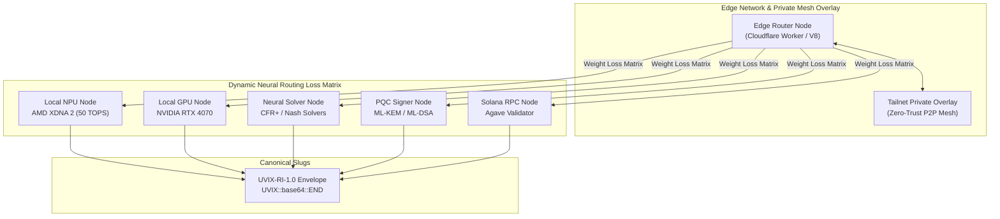

# UVIX-SOL: Post-Quantum Cryptography, Solana On-Chain Verification & Neural Mesh Edge Network

[](https://solana.com)
[](#3-sol-uvix-protocol-suite-uvix-ri-10)
[-black)](#4-post-quantum-cryptography-corecrypto)
[](#2-neural-mesh-topology-within-an-edge-network-coremesh)
[%20%7C%20RTX%204070-76B900)](#5-heterogeneous-hardware-workload-split-corehardware)
[](https://opensource.org/licenses/MIT)

UVIX-SOL is a high-performance modular protocol suite combining **Solana on-chain state verification**, **lattice-based post-quantum cryptography (PQC)**, **a dynamic neural mesh topology across edge networks**, and **heterogeneous hardware acceleration (AMD XDNA 2 NPU + NVIDIA RTX discrete GPU)**.

---

## 1. Modular Architecture Overview

The repository is organized into cleanly decoupled, nested subsystems under `core/`:

```
UVIX-SOL/
├── core/
│   ├── mesh/                   # Neural Mesh Topology & Edge Network Routing
│   │   ├── node.py             # MeshNode, NodeType, Capacity & Telemetry models
│   │   ├── topology.py         # Dynamic routing graph & neural loss weight matrix
│   │   ├── edge_network.py     # Edge overlay manager & Tailscale peer discovery
│   │   └── router.py           # UVIX-RI-1.0 packet dispatcher & pathfinder
│   ├── crypto/                 # Post-Quantum & Hybrid Cryptography
│   │   ├── pqc.py              # ML-KEM (Kyber) & ML-DSA (Dilithium) + X25519 fallback
│   │   ├── pqc_api.py          # Cryptographic REST API endpoints
│   │   └── pqc_files.py        # Authenticated key storage & sealed envelopes
│   ├── intelligence/           # Neural Strategy & Game-Theoretic Solvers
│   │   ├── processor.py        # AI reasoning & heuristic synthesis
│   │   ├── router.py           # Multi-provider LLM routing (local & external)
│   │   ├── dossier.py          # Opponent intelligence & historical profiling
│   │   ├── equity.py           # Monte Carlo equity simulation
│   │   ├── nash.py             # CFR+ Nash equilibrium solver
│   │   ├── engine.py           # State evaluation engine
│   │   ├── server.py           # API server daemon
│   │   └── vector_store/       # FAISS vector store & embeddings
│   ├── hardware/               # Heterogeneous Workload Split
│   │   ├── orchestrator.py     # HardwareWorkloadOrchestrator
│   │   ├── npu_engine.py       # AMD XDNA 2 NPU DirectML text offload
│   │   └── gpu_pipeline.py     # NVIDIA RTX 4070 NVENC/NVDEC & CUDA raster pipeline
│   └── protocol/               # Solana Wire & UVIX-RI-1.0 Protocol Envelopes
│       ├── codec.py            # Canonical JSON & SHA-256 payload integrity hashing
│       ├── transactions.py     # VersionedTx (v0), ALTs, ComputeBudget fees
│       ├── tokens.py           # SPL Token & Token-2022 TLV extension decoders
│       ├── pumpfun.py          # Pump.fun bonding curves & simulation math
│       ├── raydium.py          # Raydium V4 AMM pools & simulation math
│       ├── ws_client.py        # PubSub WebSocket client
│       ├── bridge.py           # Edge worker client & webhook dispatch
│       ├── cli_wrapper.py      # Agave/Solana CLI wrapper
│       └── client.py           # Solana RPC client
├── sol_uvix/                   # Facade & backward-compatibility package
├── edge/                       # Edge Network Runtime
│   ├── worker.ts               # Cloudflare Worker edge router & D1 telemetry sink
│   └── wrangler.toml           # Cloudflare Wrangler configuration template
├── solana/                     # Solana On-Chain Programs
│   └── wecrypto/               # Complete Anchor Rust program suite
├── idl/                        # Program IDLs (canonical schemas)
├── config/                     # Topology schemas & configuration templates
│   ├── models.json             # AI routing model definitions
│   └── tailnet.template.json   # Sanitized Tailscale mesh configuration template
├── scripts/                    # Hardware split & automation setup scripts
└── tests/                      # Automated test suite (Pytest + Node.js)
```

---

## 2. Neural Mesh Topology within an Edge Network (`core/mesh`)

The mesh system dynamically models an edge network of heterogeneous nodes (Cloudflare Workers, local NPU/GPU machines, and private Tailscale nodes):



### Dynamic Neural Weight Calculation
Tasks are routed using a multi-factor loss function:
$$\text{Cost} = w_1 \cdot \ln(1 + \text{Latency}) + w_2 \cdot \frac{1}{1.01 - \text{Load}} + w_3 \cdot \text{AffinityPenalty} + w_4 \cdot \text{ErrorPenalty}$$

- **Text / Token Offload**: High affinity for `NPU_ACCELERATOR`
- **Video / Raster Render**: High affinity for `GPU_COMPUTE`
- **Solana Instructions**: High affinity for `SOLANA_VALIDATOR`
- **State Signatures**: High affinity for `PQC_SIGNER`
- **Game Theory**: High affinity for `NEURAL_SOLVER`

---

## 3. SOL-UVIX Protocol Suite (`UVIX-RI-1.0`)

All cross-node messages, blockchain states, and hardware results are encapsulated in deterministic **UVIX Slugs**:

$$\text{UVIX}::\text{Base64}\left(\text{CanonicalJSON}\left(\text{Slug}\right)\right)::\text{END}$$

Every slug includes a deterministic sorted-key SHA-256 payload integrity hash (`payload_hash`), enabling zero-trust verification across language runtimes (Python, TypeScript, Rust).

### Solana Decoders:
- **Versioned Transactions (`v0`)**: Decodes transaction wire formats, Address Lookup Tables (ALTs), signer/writable permissions, and priority fees.
- **SPL Token-2022**: Decodes TLV extensions including `TransferFeeConfig`, `InterestBearingConfig`, and `TokenMetadata`.
- **DEX Bonding Curves**: Binary decoders and constant-product swap simulations for Pump.fun and Raydium V4 pools.

---

## 4. Post-Quantum Cryptography (`core/crypto`)

Lattice-based quantum-resistant cryptography implementing:
- **ML-KEM (Kyber)**: Key encapsulation mechanism for quantum-safe key exchange.
- **ML-DSA (Dilithium)**: Digital signature algorithm for authenticating state turn proofs.
- **Classical Fallback**: Hybrid X25519 / Ed25519 mode with AES-256-GCM symmetric payload encryption.

---

## 5. Heterogeneous Hardware Workload Split (`core/hardware`)

| Workload Type | Assigned Hardware | Execution Engine | Protocol Layer |
| :--- | :--- | :--- | :--- |
| **NLP & Text Embeddings** | **AMD Ryzen AI 9 HX 370 (NPU)** | AMD XDNA 2 (50 TOPS) via DirectML | `npu-text-v1` |
| **Video Transcoding** | **NVIDIA RTX 4070 Laptop GPU** | NVENC / NVDEC hardware encoders | `gpu-video-raster-v1` |
| **Raster Compute & 3D** | **NVIDIA RTX 4070 Laptop GPU** | Ada Lovelace CUDA / Direct3D12 | `gpu-video-raster-v1` |

---

## 6. Solana On-Chain Program: `WeCrypto` (`solana/wecrypto`)

- **Program ID**: `9HLcTyxqXTimBXj9RvP2dZtTwZsNdzdiGRNRdUTTUp5B`
- **Canonical IDL**: [`idl/wecrypto.json`](idl/wecrypto.json)
- **Framework**: Anchor `1.2.1` / Agave SDK `v3.1+` / Rust `1.89+`

### Instructions:
- `initialize`: Singleton `GlobalConfig` initialization with admin authority.
- `record_turn_proof`: Commits monotonic state hashes anchored to proof turns and slot height.
- `commit_prediction`: Cryptographically commits market probability forecasts before expiration horizons.
- `resolve_prediction`: Records realized market outcomes and quadratic Brier score loss.
- `log_token_signal`: Stores on-chain forensic assessment (risk score, LP burn/lock status, bundle detection).
- `update_config`: Administrative pause controls and authority migration.

---

## 7. Setup & Configuration

### Prerequisites
- Python 3.10+ (Python 3.13 recommended)
- Node.js 20+
- Rust 1.89+ / Solana CLI / Anchor 1.2.1

### Environment Configuration
Copy template configurations to initialize your environment:
```bash
cp config/tailnet.template.json config/tailnet.json
cp edge/wrangler.toml edge/wrangler.local.toml
```

Set environment variables in `.env`:
```bash
SOLANA_RPC_URL="https://api.devnet.solana.com"
UVIX_GATEWAY_URL="https://edge.yourdomain.com/uvix"
TAILNET_CONFIG_PATH="config/tailnet.json"
```

### Running Tests
Execute the full test suite (34 unit tests):
```bash
py -3.13 -m pytest -v
```

Execute cross-runtime Node.js verification:
```bash
node tests/test_roundtrip.js
```

---

## 8. License

MIT © [UVIX-SOL Maintainers](https://github.com/JohnDaWalka/UVIX-SOL).
