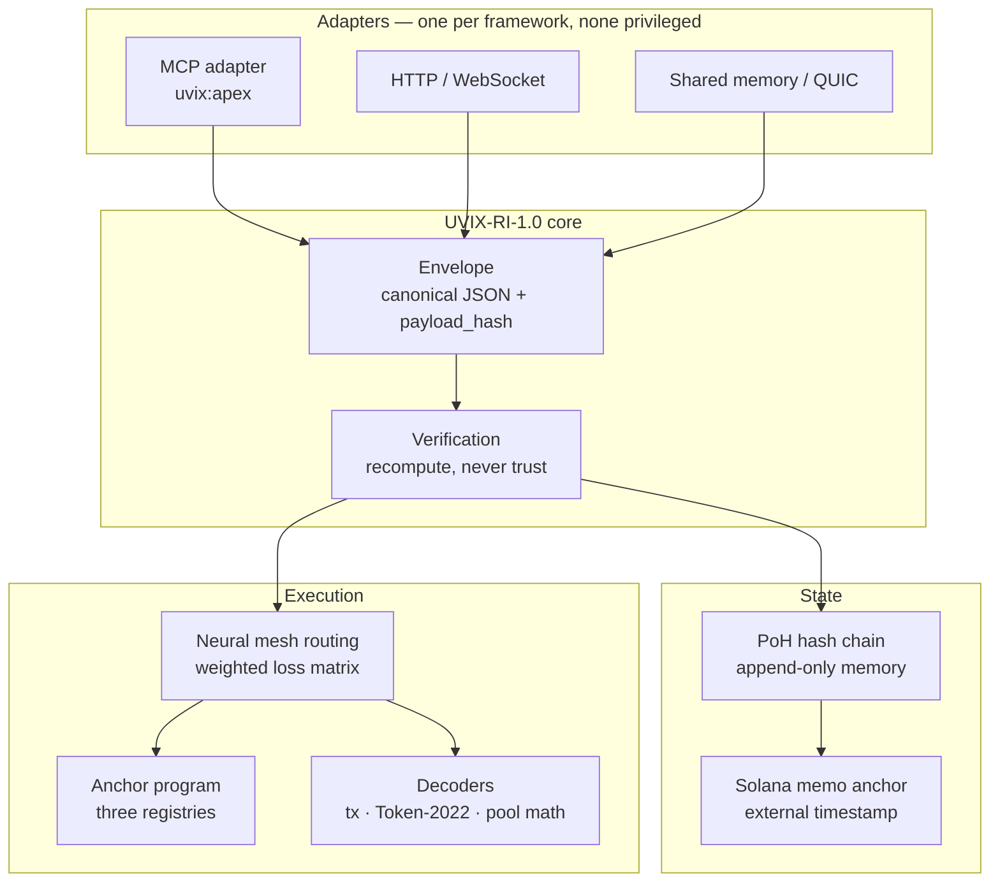
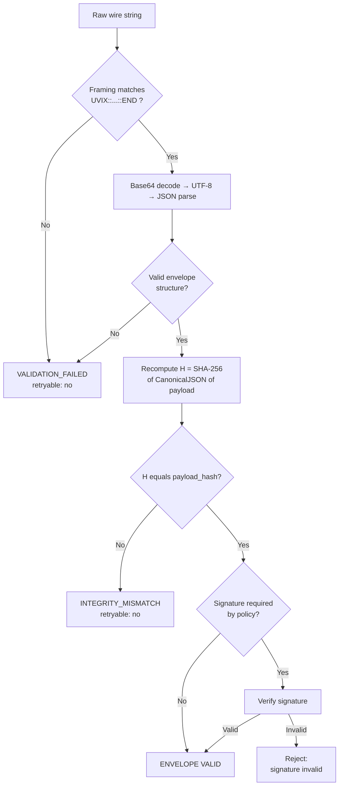
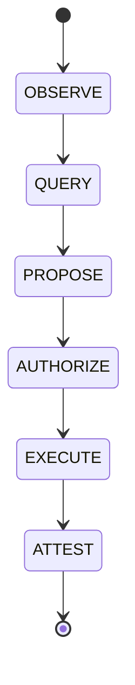
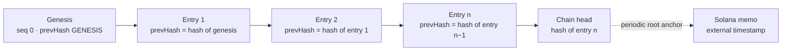
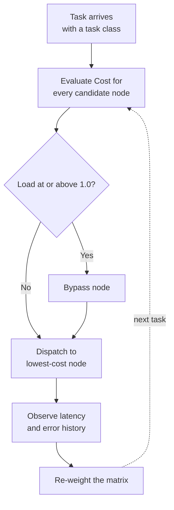

# UVIX-SOL

[](#6-the-envelope-uvix-ri-10)
[](#5-canonical-serialization-jcs)
[](#12-the-on-chain-program)
[-black)](#11-post-quantum-core)
[](LICENSE)

**UVIX-SOL is a modular protocol suite for verifiable state across untrusted machines:** a Solana program holding three registries, an append-only hash chain that remembers what the mesh agreed on, a deterministic wire envelope three languages can check against each other, lattice-based post-quantum cryptography, and a neural routing layer.

> **This README is the specification.** It defines the canonical serialization rules, the UVIX-RI-1.0 wire envelope, the proof-of-history persistence chain, and the conformance vectors — with the worked examples generated by the reference codec in this repository, so every hash printed here recomputes. If an example ever fails to recompute, the example is wrong, not the math.

What it runs on, where it runs, and who runs it are not documented here. That is deliberate. This document describes the machine, not its keeper.

**Contents**

- [1. Names](#1-names)
- [2. Design principles](#2-design-principles)
- [3. What the suite does](#3-what-the-suite-does)
- [4. Repository map](#4-repository-map)
- [5. Canonical serialization (JCS)](#5-canonical-serialization-jcs)
- [6. The envelope: UVIX-RI-1.0](#6-the-envelope-uvix-ri-10)
- [7. Message classes: observation is not authority](#7-message-classes-observation-is-not-authority)
- [8. Proof-of-history persistence](#8-proof-of-history-persistence)
- [9. Neural mesh routing](#9-neural-mesh-routing)
- [10. Protocol decoders](#10-protocol-decoders)
- [11. Post-quantum core](#11-post-quantum-core)
- [12. The on-chain program](#12-the-on-chain-program)
- [13. Cross-chain export](#13-cross-chain-export)
- [14. Funding layer: USDC micropayments for inference](#14-funding-layer-usdc-micropayments-for-inference)
- [15. Tracks: separate routes, one protocol](#15-tracks-separate-routes-one-protocol)
- [16. Configuration philosophy](#16-configuration-philosophy)
- [17. Tests](#17-tests)
- [18. Status](#18-status)
- [19. License and trademarks](#19-license-and-trademarks)

## 1. Names

**UVIX** is the namespace — one family's rules for naming things and packaging claims so that any program can check them byte-for-byte without trusting the sender. It is short for **Universal-Inter-Cross-Compatability**; the spelling is canonical, part of the identity. UVIX is not an external standard (not IETF, not ISO, not Solana) and admits no members: a program conforms by producing and checking envelopes the UVIX-RI way — nothing is issued, granted, or joined.

Three more names live under it, each defined once, by relation:

| Name | What it is |
| :--- | :--- |
| **`uvix`** | The Node build entry point the namespace grew out of. The tooling came first. |
| **UVIX-RI-1.0** | The wire/envelope protocol defined under UVIX (§6). |
| **UVIX-SOL** | This system: UVIX-RI-1.0 applied to Solana, persistence, cryptography, routing, and decoding. |

## 2. Design principles

- **Determinism over trust.** Every cross-node claim is packaged so any node, in any runtime, can recompute it byte-for-byte. Nothing is believed because of who sent it.
- **Append-only memory.** History is a hash chain. Entries are never edited, only superseded. A disagreement about the past is settled by recomputation, not authority.
- **Commit before outcome.** Predictions are sealed on-chain before their horizons expire and scored after the fact, in the open, by formula.
- **Observation is not authority.** Receiving information never, by itself, grants permission to act (§7).
- **Opacity is a feature.** The repository ships templates, schemas, and proofs — never topology, membership, endpoints, or operator detail. A reader can verify everything about how the system works and learn nothing about where it sleeps.

## 3. What the suite does

| Layer | Responsibility |
| :--- | :--- |
| On-chain program | Three registries: prediction commitments, proof-of-history turn proofs, token forensic signals |
| PoH persistence | Hash-chained, append-only log of mesh state, with witness failover and periodic on-chain root anchoring |
| Envelope protocol | Canonical-JSON slugs with deterministic SHA-256 integrity hashes, identical across Python, TypeScript, and Rust |
| Neural mesh | Dynamic routing over a weighted loss matrix — latency, load, affinity, error history |
| Funding layer | USDC micropayments for inference across the fleet — devnet-first, metered per call |
| PQC core | ML-KEM key encapsulation, ML-DSA signatures, hybrid classical fallback |
| Decoders | Versioned transactions, Token-2022 TLV extensions, bonding-curve and AMM pool math |



The protocol stack, bottom to top. Semantics do not change when the bottom layers change — that is the property that turns a build slug into an interoperability protocol:

| Layer | Name | Carries |
| :--- | :--- | :--- |
| UVIX-6 | POLICY | Authorization, deadlines, constraints |
| UVIX-5 | TRUST | Identity, signatures, provenance, evidence |
| UVIX-4 | STATE | Version, freshness, ownership, replication |
| UVIX-3 | CAPABILITY | Discover, query, invoke, subscribe |
| UVIX-2 | ENVELOPE | UVIX-RI-1.0 — identity, trace, type, payload |
| UVIX-1 | TRANSPORT | SHM, QUIC, TCP, HTTP, MCP, private IP |
| UVIX-0 | PHYSICAL | Loopback, LAN, Internet, fiber |

## 4. Repository map

```
UVIX-SOL/
├── core/
│   ├── mesh/            # Neural topology, routing graph, loss matrix, envelope dispatch
│   ├── crypto/          # ML-KEM / ML-DSA, hybrid fallback, sealed key storage
│   ├── intelligence/    # Reasoning, dossier profiling, Monte Carlo equity, CFR+ solver
│   ├── hardware/        # Heterogeneous workload split across accelerator classes
│   └── protocol/        # Wire codec, transaction & token decoders, RPC / PubSub clients
├── persistence/         # Proof-of-history chain node (UVIX-RI-1.0) & operator runbook
├── funding/             # USDC micropayment layer for inference (devnet-first)
├── sol_uvix/            # Facade & backward-compatibility package
├── edge/                # Edge runtime: request router & telemetry sink
├── solana/wecrypto/     # The on-chain program (Anchor / Rust)
├── idl/                 # Canonical program IDL schemas
├── config/              # Topology schemas & sanitized configuration templates
├── scripts/             # Setup & automation
└── tests/               # Pytest + Node.js cross-runtime verification
```

## 5. Canonical serialization (JCS)

Every hash in this system is computed over one canonical byte representation. UVIX-RI-1.0 canonical JSON follows **RFC 8785 (JSON Canonicalization Scheme)**:

- **No insignificant whitespace.** Separators are exactly `,` and `:`.
- **Key ordering by UTF-16 code units.** Object keys sort by their UTF-16 code-unit sequence — *not* by Unicode code point. Runtimes whose native comparison is code-point order (e.g. Python) must encode keys to UTF-16 big-endian before comparing. Consequence: characters outside the Basic Multilingual Plane (surrogate pairs, first code unit `0xD800–0xDBFF`) sort **before** BMP Private Use characters (`0xE000–0xFFFF`).
- **Escaping is minimal.** Only `"` → `\"`, `\` → `\\`, and control characters `U+0000–U+001F` (`\b \t \n \f \r` or `\u00xx`, lowercase hex) are escaped. Every other character is emitted as literal UTF-8 — `\u00e9`-style escapes for ordinary characters are non-canonical.
- **Numbers follow ECMAScript serialization** (the RFC 8785 rule): integers in `[-2^53 + 1, 2^53 - 1]` carry no decimal point; zero is `0`, never `-0`; magnitudes that require exponential form use lowercase `e`, a sign on positive exponents, and no leading zeros — `1e+21`, `1e-7`.

**Conformance vector — key ordering.** For the object

```json
{ "\u0000": "null_byte", "a": 2, "z": 1, "😀": "grinning_face_U+1F600", "\uE000": "pua_U+E000", "\uFFFF": "bmp_max_U+FFFF" }
```

the canonical serialization is (UTF-8, shown as hex):

```
7b225c7530303030223a226e756c6c5f62797465222c2261223a322c227a223a312c22f09f9880223a226772696e6e696e675f666163655f552b3146363030222c22ee8080223a227075615f552b45303030222c22efbfbf223a22626d705f6d61785f552b46464646227d
```

- Length: **107 bytes**
- SHA-256: **`f80fd0df17b7ffa7123badbaf98df5a8f6293213901a8702ae2d323f73026d8c`**

Note the order in the bytes: the astral key 😀 (UTF-16 lead surrogate `0xD83D`) precedes the U+E000 key, exactly as the UTF-16 rule requires — and exactly where code-point ordering would put it last-but-one instead. This vector exists to catch that bug.

## 6. The envelope: UVIX-RI-1.0

Every message, state snapshot, and result that crosses a node boundary is wrapped as a slug:

```
UVIX::Base64( CanonicalJSON(Envelope) )::END
```

There is no whitespace or trailing data outside the `UVIX::` and `::END` tokens. Because encoding is canonical, two encoders given the same envelope produce the identical wire string — the slug itself is comparable and hashable.

### 6.1 Envelope fields

| Field | Type | Meaning |
| :--- | :--- | :--- |
| `v` | String | Protocol version — `"UVIX-RI-1.0"` |
| `id` | String | Envelope identifier |
| `type` | String | Capability being invoked or reported (e.g. `price.current`) |
| `source` | String | Originator identity (`uvix:` URI) |
| `target` | String | Intended recipient, or a broadcast indicator |
| `created_ns` | String | Creation time, nanoseconds since Unix epoch (a string: ns timestamps exceed `Number.MAX_SAFE_INTEGER`, and a reference codec does not silently lose precision) |
| `trace` | Object | Causality chain — `trace_id`, optional `parent_id` |
| `policy` | Object \| null | Deadline / priority budget — numbers are per-deployment policy, not protocol constants |
| `class` | String | Message class (§7): `OBSERVE`, `QUERY`, `PROPOSE`, `AUTHORIZE`, `EXECUTE`, or `ATTEST` |
| `payload` | Any | The canonical data object carrying the message |
| `evidence` | Array | Provenance entries: source, digest, observation time |
| `payload_hash` | String | 64-char lowercase hex SHA-256 of the payload (§6.2) |
| `signature` | Object | Optional — authentication container (§6.5): `alg`, `kid`, `sig` |

### 6.2 Payload hash: coverage, not tagged domain separation

```
payload_hash = SHA-256( UTF-8( CanonicalJSON(payload) ) )
```

The hash is computed over the **payload only**. The envelope fields — `v`, `id`, `type`, `source`, `target`, `created_ns`, `trace`, `policy`, `class`, `evidence`, `payload_hash` itself, and `signature` — are **excluded** from the input. The definition is therefore not circular, and a payload's hash is stable no matter how it is routed, traced, or re-wrapped.

Precision about terms: this defines hash **coverage** — which bytes are inside the digest. It is *not* cryptographic domain separation in the tagged-digest sense. RI-1.0 uses no domain tag: the payload hash and the PoH entry hash (§8) are both bare SHA-256 over canonical JSON, so a digest value alone does not prove which function produced it — the verification context does, and a bare digest must never be presented as proof of its own type. Adding domain tags would change every digest the system has ever produced, so tagged separation is reserved for a future breaking version, never retrofitted silently.

### 6.3 Worked example (generated by the reference codec in this repo)

```json
{
  "v": "UVIX-RI-1.0",
  "id": "readme-example-0001",
  "type": "price.current",
  "source": "uvix:oracle:price",
  "target": "mesh-broadcast",
  "created_ns": "1793292600000000000",
  "trace": { "trace_id": "readme-trace-0001" },
  "policy": null,
  "class": "OBSERVE",
  "payload": { "symbol": "BTC/USDC", "mark_price": 68450.25 },
  "evidence": [],
  "payload_hash": "3957ffbdb34c1e127bdee281a2869ea2339012db12e13ce3bdcabf9df5a4d0f0"
}
```

Check it by hand: the canonical payload is `{"mark_price":68450.25,"symbol":"BTC/USDC"}` — keys reordered, no whitespace — and its SHA-256 is the `payload_hash` above. On the wire, the same envelope is:

```
UVIX::eyJjbGFzcyI6Ik9CU0VSVkUiLCJjcmVhdGVkX25zIjoiMTc5MzI5MjYwMDAwMDAwMDAwMCIsImV2aWRlbmNlIjpbXSwiaWQiOiJyZWFkbWUtZXhhbXBsZS0wMDAxIiwicGF5bG9hZCI6eyJtYXJrX3ByaWNlIjo2ODQ1MC4yNSwic3ltYm9sIjoiQlRDL1VTREMifSwicGF5bG9hZF9oYXNoIjoiMzk1N2ZmYmRiMzRjMWUxMjdiZGVlMjgxYTI4NjllYTIzMzkwMTJkYjEyZTEzY2UzYmRjYWJmOWRmNWE0ZDBmMCIsInBvbGljeSI6bnVsbCwic291cmNlIjoidXZpeDpvcmFjbGU6cHJpY2UiLCJ0YXJnZXQiOiJtZXNoLWJyb2FkY2FzdCIsInRyYWNlIjp7InRyYWNlX2lkIjoicmVhZG1lLXRyYWNlLTAwMDEifSwidHlwZSI6InByaWNlLmN1cnJlbnQiLCJ2IjoiVVZJWC1SSS0xLjAifQ==::END
```

### 6.4 Verification

A conforming validator runs these checks **in this order** and aborts on the first failure. No payload reaches an application handler on an integrity failure.



Validators reject, rather than repair: duplicate object keys, lone surrogates, non-canonical bytes presented as canonical, malformed Base64 padding, and schema violations are all failures, not normalization opportunities. Two validators that accept different byte representations of the same logical envelope have already diverged — the strictness is the interoperability.

Enforcement status, stated plainly: the reference decoder enforces every item on that list at the wire boundary — it rejects characters outside the framing, decodes UTF-8 fatally, requires the Base64 to be the canonical encoding of its own bytes, scans for lone surrogates, and re-canonicalizes the decoded envelope and compares bytes, which is what catches duplicate keys and non-canonical forms (including non-JCS number spellings such as `1e21`). Its strictness suite covers each rejection case individually, alongside the tamper case that must land on `INTEGRITY_MISMATCH`, not `VALIDATION_FAILED`.

### 6.5 Integrity is not authentication

`payload_hash` proves the payload bytes are the bytes that were hashed. It does **not** prove who hashed them: the hash is unkeyed, and anyone can replace a payload and recompute it. Authentication is a separate layer (UVIX-5, §11), verified after integrity — never instead of it. Routing fields (`source`, `target`, `type`) sit outside the payload hash by design; the signature below is what covers them.

**Signature format (exact).** When present, the `signature` field is an object with exactly three members:

| Member | Meaning |
| :--- | :--- |
| `alg` | Algorithm identifier: `"Ed25519"` or `"ML-DSA-65"` |
| `kid` | Key identifier — names the verification key and, with `alg`, how to verify |
| `sig` | The signature bytes, Base64url-encoded without padding |

**Signing input (exact).** The signature is computed over

```
UTF-8( CanonicalJSON( envelope with the "signature" member removed ) )
```

— every other member present, including `payload_hash`, `source`, `target`, and `type`. The `signature` member is excluded by removal, so there is no circularity and no ambiguity about what is covered. Verification mirrors it: parse, check `payload_hash` first, then remove `signature`, canonicalize, and verify `sig` under the key named by `kid`; an unknown `kid`, an `alg` that does not match that key, or a failed verification is a rejection. A verifier must never verify over a re-serialization it invented — the input is the canonical form of the received envelope minus the one member, nothing else.

Interoperability under UVIX-RI-1.0 means exactly one thing: for the same protocol object, implementations in different runtimes produce the identical canonical representation and the identical verification result. Nothing weaker counts.

## 7. Message classes: observation is not authority

Every envelope carries a `class`. The classes are a ladder, and a message may only climb it through explicit transitions:



| Class | Meaning |
| :--- | :--- |
| `OBSERVE` | A fact was seen. Grants nothing. |
| `QUERY` | A question was asked. Grants nothing. |
| `PROPOSE` | An action was suggested. Grants nothing. |
| `AUTHORIZE` | A principal approved the action. |
| `EXECUTE` | The action was carried out. |
| `ATTEST` | The result was recorded as evidence. |

Implementations may collapse stages only when policy explicitly allows it; the semantics remain distinct. An agent's `PROPOSE` never executes without a principal's `AUTHORIZE` — this is the protocol form of the manual-execution rule the whole suite is operated under.

## 8. Proof-of-history persistence

UVIX proof-of-history persistence is the suite's application-level append-only hash-chain mechanism, distinct from Solana's Proof of History consensus clock. One entry per agreed fact:

```
entry = { node, prevHash, seq, text, ts }
hash  = SHA-256( CanonicalJSON(entry) )
```

- `seq` is monotonic per node, starting at `0`.
- The genesis entry's `prevHash` is the literal string `"GENESIS"`.
- Every later entry's `prevHash` is the previous entry's `hash`, where `hash` is computed over the five fields above — the hash field itself is not part of its own input.
- `ts` is non-decreasing along the chain.



Break any link and every later hash fails. Recomputation is total *for internal consistency*: any holder of the chain can recompute every hash from genesis and confirm that the presented chain is self-consistent and ends at its presented head, with no trusted checkpoint needed for that check. What recomputation alone cannot do is detect a wholesale replacement chain — a different, equally self-consistent history recomputes just as cleanly. Detecting replacement requires a previously known head, or the external anchor below, as the commitment to compare against.

Entries are validated, then witnessed — a primary witness countersigns, peers witness in failover order. An unwitnessed entry is local-flagged: valid, but marked not yet corroborated, and swept up by periodic reconciliation. At fixed intervals the chain's head hash is committed to Solana in a memo transaction, giving the mesh's memory an external timestamp it cannot forge after the fact.

What anchoring proves, stated precisely: the head hash existed at or before the anchor's slot. The chain is **tamper-evidence against a known commitment** — recompute it and any edit shows. Anchoring does not certify that the claims inside entries are true, nor that a presented history is complete; it certifies that *this* history, the one whose head was anchored, has not changed since.

The chain is young. Its first seals are set; its witnesses are still gathering. That is the correct order — memory first, corroboration second, anchoring when the cadence calls for it.

## 9. Neural mesh routing

Work is routed by a multi-factor loss function evaluated per task class:

```
Cost = w1·ln(1 + Latency) + w2·(1 / (1.01 − Load)) + w3·AffinityPenalty + w4·ErrorPenalty
```

with non-negative weights `w1…w4` and `Load ∈ [0, 1]`. As `Load` approaches 1 from below, the load term approaches `100 · w2` — steep, but finite; the formula's singularity sits at `Load = 1.01`, outside the operating domain. The bypass at `Load ≥ 1` is a separate hard rule, not a limit of the formula.



Task classes carry affinities — text and embedding work gravitates to one accelerator class, raster and video to another, chain instructions to validator-adjacent nodes, signatures to the cryptographic signer class, game-theoretic solving to the solver class. The matrix is re-weighted by observed latency and error history; the mesh learns which of its limbs are fast and reliable.

Node classes, capacities, and membership are runtime facts, discovered through the overlay, never published here.

## 10. Protocol decoders

- **Versioned transactions (v0):** full wire decoding — address lookup tables, signer/writable permission maps, compute-budget and priority-fee extraction.
- **SPL Token-2022:** raw TLV extension parsing, including TransferFeeConfig (with epoch-scheduled fee changes), InterestBearingConfig, PermanentDelegate, and TokenMetadata — decoded from bytes, not from anyone's API summary.
- **Market structures:** bonding-curve mathematics and constant-product pool simulation for launchpad and AMM venues, computed locally from first principles.

## 11. Post-quantum core

- **ML-KEM (FIPS 203):** quantum-resistant key encapsulation for node-to-node key exchange.
- **ML-DSA (FIPS 204):** lattice signatures authenticating state turn proofs.
- **Hybrid fallback:** X25519 / Ed25519 with AES-256-GCM sealed payloads, for peers and paths where the lattice suite is not yet negotiated.

| Primitive | Parameter set | Public key | Ciphertext / Signature | Shared secret |
| :--- | :--- | :--- | :--- | :--- |
| ML-KEM | ML-KEM-768 | 1,184 bytes | 1,088 bytes (ciphertext) | 32 bytes — the direct ML-KEM output |
| ML-DSA | ML-DSA-65 | 1,952 bytes | 3,309 bytes (signature) | — |
| Hybrid fallback | X25519 + Ed25519 + AES-256-GCM | 32 bytes each | — | 32 bytes |

ML-KEM's shared secret *is* its output; there is no derivation step inside the KEM. Where a deployment profile derives session keys from that secret with HKDF-SHA256, the HKDF is a separate, additional step, and the profile must specify its own salt, info string, and output length — none of which is defined by, or inherited from, ML-KEM itself.

Keys live in sealed, authenticated storage. Key material, like topology, is never in this repository — only the mathematics that uses it.

## 12. The on-chain program

A single Anchor program holds the suite's public memory:

- **Program ID:** `9HLcTyxqXTimBXj9RvP2dZtTwZsNdzdiGRNRdUTTUp5B`
- **Canonical IDL:** `idl/wecrypto.json`

| Instruction | Semantics |
| :--- | :--- |
| `initialize` | Creates the singleton GlobalConfig; establishes the authority |
| `commit_prediction` | Seals a market probability forecast before its expiration horizon |
| `resolve_prediction` | Records the realized outcome; scores the commitment by quadratic (Brier) loss |
| `record_turn_proof` | Anchors a monotonic state hash to a proof turn and slot height |
| `log_token_signal` | Stores a forensic assessment: risk score, LP burn/lock status, bundle detection |
| `update_config` | Administrative pause controls and authority migration |

Three registries, one program: what was predicted, what was proven, what was flagged. Commitments cannot be backdated, resolutions cannot be un-scored, and signals cannot be quietly removed.

The program's deployment state is a fact of the chain, not of this document. Consult the chain.

## 13. Cross-chain export

The mesh's memory does not have to stay on the chain where it was written. Chainlink CCIP is the designated cross-chain transport: PoH root anchors and exported state — inference results, memory-state roots — leave their home chain as CCIP messages and arrive verifiable on the destination under the same rule as everything else here. The payload is canonical, the hash is recomputed on arrival, and the envelope does not care which chain it lands on.

- **Lanes:** Solana ↔ EVM, both directions, testnet and mainnet — confirmed in Chainlink's own directory, not assumed.
- **Double verification:** CCIP's security layer attests to the transport; the UVIX `payload_hash` attests to the content. A root is checkable twice, by two systems that owe each other nothing.
- **CRE:** Chainlink's Runtime Environment is under evaluation as an external compute and verification environment for these exports.

Status, stated plainly: designated and lane-verified, not yet load-bearing. The memo anchor (§8) is what runs today. CCIP is where the roots go when they start to travel.

## 14. Funding layer: USDC micropayments for inference

Inference is metered per call and paid in USDC micro-amounts on Circle's rails — sub-cent to cents per call, priced by model class from a published table (1 USDC = 1,000,000 micro-units).

- **Devnet-first.** Development and day-to-day fleet use run on Solana devnet with Circle test USDC, from a dedicated funding wallet holding a working float. The economics are proven where mistakes are free; mainnet is a promotion, not a starting point.
- **Fast at call time.** A call never blocks on a settlement confirmation. Dispatch is optimistic against the funded float and the caller's budget caps; metering is local and immediate, settlement batches on a cadence. The chain confirms history; it does not gate it.
- **Receipts are slugs.** Every paid call produces a UVIX-RI-1.0 receipt — quote, payment reference, model class, payload hash — recorded in the proof-of-history chain (§8) like any other agreed fact.
- **Budget policy is explicit.** Per-call caps, per-agent daily caps, and a kill switch bound the float. An agent that hits its cap stops spending, not thinking — local work continues, paid work queues.

Status: design. The full specification lives in `funding/`.

## 15. Tracks: separate routes, one protocol

Each track is its own route — its own deployment, cadence, and failure domain — and all of them speak the same envelope (§6) and register in the same manifest. Routes multiply; formats don't.

| Track | Carries | Character |
| :--- | :--- | :--- |
| Data | Market feeds, oracle data feeds, price proxies | Read-only, cacheable, hot |
| Interop | Cross-chain export (§13), on-chain anchors (§8) | Data-only, batch cadence |
| Value | The funding layer (§14) — the only track that moves money | Capped, pausable, gated |
| Memory | Proof-of-history persistence and root publication | Append-only |
| Inference | Model backends, paid per call by the value track | Routed (§9), metered (§14) |

The separation is the safety property: the value track can be frozen by its kill switch while data keeps flowing; the interop track can lag a batch while memory keeps appending; a data feed can die without taking inference with it. What never forks is the layer underneath — one slug namespace, one registry, one chain. A new capability joins by taking a route on the appropriate track, not by moving into a neighbor's.

## 16. Configuration philosophy

The repository contains templates — `config/` holds topology schemas, the edge runtime ships a sanitized configuration template. Real configuration is assembled at deployment time, elsewhere, from material that never enters version control. If you are reading this repository to find the network, you are reading the wrong artifact: everything here is the shape of the system, none of it is the system.

## 17. Tests

```
py -3.13 -m pytest -v          # unit & protocol suites
node tests/test_roundtrip.js   # cross-runtime envelope verification
```

The roundtrip test protects the foundational invariant: the same logical slug, canonicalized independently in every supported runtime, must produce the same bytes and the same hash. Cryptographic verification, chain continuity, decoder correctness, routing behavior, and on-chain state transitions are tested as independent invariants built on top of that common representation.

## 18. Status

Under active development by its maintainers. The envelope is stable at UVIX-RI-1.0. The chain remembers. The program awaits its day on-chain. Further detail is available to those who already know where to ask.

## 19. License and trademarks

UVIX-SOL is proprietary software. All rights reserved. It is not distributed under an open-source license; access to the source code does not by itself grant permission to copy, modify, redistribute, sublicense, sell, commercially exploit, or create derivative works from it. See [LICENSE](LICENSE) for the complete terms.

UVIX™, UVIX-SOL™, UVIX-RI™, UVIX-RI-1.0™, and Universal-Inter-Cross-Compatability™ are project names and source identifiers. Trademark rights are separate from the software copyright license. See [TRADEMARKS.md](TRADEMARKS.md) for the trademark notice.

Third-party components remain subject to their respective licenses and notices.
