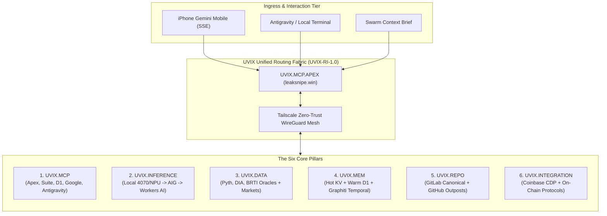
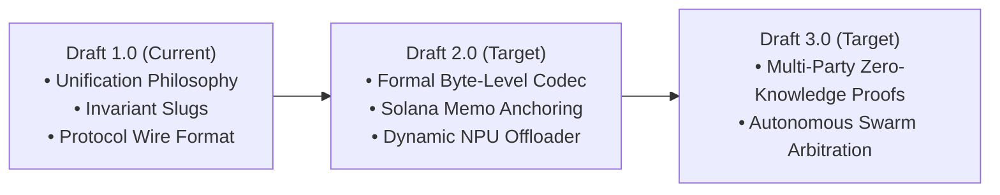

# UVIX: Universal Vector Interchange & Inter-Cross-Compatibility Nexus
## Specification & Architectural Whitepaper — Draft 1.0
**Protocol Standard:** `UVIX-RI-1.0`  
**Author / Principal Architect:** Mauro Mark Nazareno Fanelli  
**System Status:** `ACTIVE` (Mesh v1.3.0)  
**Date:** November 2026  

---

## 1. Executive Summary & Genesis

The modern computational landscape is severely fractured. Operating systems, network tiers, hardware architectures, database engines, and AI models exist as walled gardens—separated by incompatible formats, disparate communication semantics, and rigid API barriers. 

**UVIX** was born out of absolute operational necessity: the demand for **Universal Inter-Cross-Compatibility**. 

Just as human society flourishes when people of diverse languages, cultures, origins, ages, races, and perspectives communicate and collaborate without artificial barriers, software and hardware systems must possess an egalitarian medium of exchange. In UVIX, an Apple iOS device on a cellular connection, an NVIDIA RTX 4070 / Neural Processing Unit (NPU) on Windows 11, a headless Linux node in WSL, a distributed Cloudflare V8 Worker at the edge, and distinct frontier AI models (Gemini, Claude, DeepSeek, Llama) all communicate as equal, interoperable peers in a single unified swarm.

```
       +-----------------------------------------------------------+
       |               UVIX UNIVERSAL INTERCHANGE                  |
       |      "Systems speaking as one, regardless of origin"      |
       +-----------------------------------------------------------+
                                     │
         ┌───────────────────────────┼───────────────────────────┐
         │                           │                           │
  [Human / User]              [Edge / Cloud]              [Local Nodes]
  • Dyscalculia-friendly      • Cloudflare Workers        • RTX 4070 (Vision)
  • Intuitive Topology        • Multi-D1 Databases        • NPU (Streamed Text)
  • Mobile SSE (iPhone)       • AI Gateways & Oracles     • Linux WSL Subnets
```

---

## 2. The Core Philosophy

### 2.1. The Dyscalculia Design Principle: Topology Over Numeric Friction
Traditional computing forces developers to constantly perform symbolic, indexing, and arithmetic conversions. For an architect living with **dyscalculia**, raw number grids, off-by-one pointer arithmetic, and rigid numeric coordinate spaces introduce unnecessary cognitive friction.

UVIX turns this perceived vulnerability into its greatest architectural strength:
* **Invariant Hierarchy Slugs**: Nodes are referenced by clear, human-readable structural slugs (`UVIX.MCP.D1`, `UVIX.DATA.ORACLE.PYTH`, `UVIX.INFERENCE.LOCAL`) rather than volatile numerical port configurations or volatile table IDs.
* **Deterministic Contract Canonicalization**: Data streams are labeled with unambiguous semantic roles (`PRIMARY SPOT ORACLE`, `SECONDARY CROSS-CHECK`) with built-in divergence thresholds rather than raw mental math.
* **Spatial & State Harmony**: System health and state are visual, declarative, and topological. If a tier falters, the failure topology routes around it automatically.

### 2.2. Etymology & Nomenclature: UX, UV, and the Latinized "IX"
* **UX (User Experience / Universal Empathy)**: Technology must serve the human operator intuitively. Complex multi-agent coordination collapses into clean natural language streams, real-time push events (SSE), and unambiguous mobile controls.
* **UV (Ultra-Velocity / Unified Vectorization)**: The underlying data transport leverages high-speed modern Linux packaging (`uv`), ultra-fast vector serialization, and direct memory-mapped pipelines.
* **IX (The Nexus / Intersection)**: Latinized Roman numeral IX (9) and the universal abbreviation for **Internet Exchange / Intersection**. It symbolizes the meeting ground—the bridge where 9 distinct architectural domains converge:
  1. *Local Neural Acceleration (RTX + NPU)*
  2. *Edge Computing (Cloudflare Workers)*
  3. *Zero-Trust Mesh (Tailscale WireGuard)*
  4. *Multi-Model Inference (Frontier + Workers AI)*
  5. *Decentralized & Multi-D1 Storage*
  6. *Financial Oracles (Pyth, DIA, BRTI)*
  7. *Prediction Markets (Kalshi, Polymarket)*
  8. *Universal Agent Swarms (Muse, Gemini, Claude, Grok)*
  9. *Mobile Edge Integration (iOS SSE Clients)*

### 2.3. Package Builds: Linux & NPM Convergence
In UVIX, the build system rejects fragile environment fragmentation. Linux package builds blend modern package management (`uv` for Python environments and standardized `npm run build` pipelines for Node/V8 Workers) to guarantee that whether code is executing on an Arch Linux subnode, a Windows command station, or an edge Worker runtime, the generated artifacts and MCP endpoints are identical, deterministic, and self-bootstrapping.

---

## 3. System Architecture & The 6 Primary Pillars



### Pillar I: UVIX.MCP (Model Context Protocol Connectors)
UVIX deploys a standardized suite of MCP connectors providing bidirectional tool invocation across models:
* **UVIX.MCP.APEX**: Master coordination worker hosted at `leaksnipe.win`.
* **UVIX.MCP.SUITE**: Tool repository offering database recovery, poker analysis, and network health.
* **UVIX.MCP.D1**: Direct SQL engine interface for serverless relational databases.
* **UVIX.MCP.GOOGLE**: Low-latency edge proxy binding Gemini multimodal streams with mobile iOS SSE.
* **UVIX.MCP.ANTIGRAVITY**: Autonomous multi-agent neural bridge operating over Tailscale RPC (`tcp://antigravity.prairiedog-godzilla.ts.net:49771`).

### Pillar II: UVIX.INFERENCE (The 4-Stage Fallback Waterfall)
Inference follows an uncompromising cost-, privacy-, and latency-tiered hierarchy:
$$\text{Local-First (RTX/NPU)} \longrightarrow \text{Cloudflare AI Gateway (AIG)} \longrightarrow \text{Frontier APIs} \longrightarrow \text{Cloudflare Workers AI}$$

1. **Local Host (`maurotufgamingp`)**: RTX 4070 (vision/complex spatial workloads) + NPU (efficient, streaming tokens) + Qwen (bulk classification).
2. **AI Gateway (`wecryp-unified`)**: Aggregates frontier routes across Claude, DeepSeek, OpenAI, Grok, Kimi, Minimax, and Mistral with unified logging and rate-limit buffering.
3. **Workers AI Edge**: Instant failover to `@cf/meta/llama-3.3-70b-instruct-fp8-fast` and `@cf/meta/llama-3.1-8b-instruct-fast` running natively inside Cloudflare's global edge network.
4. **UVIX Solver**: High-precision GTO calculation cluster with a 200ms circuit breaker and automatic failover into D1 memory.

### Pillar III: UVIX.DATA (The Strict Oracle Doctrine)
> [!IMPORTANT]
> **Core Doctrine**: *PYTH_AND_ORACLE_ONLY*. Never CoinGecko, never raw unverified CEX tapes.

* **Primary Spot Oracle**: Pyth Network Hermés V2 (`updates/price/latest`).
* **Cross-Check Oracle**: DIA Proxy (`dia.leaksnipe.win`), triggering automated divergence alerts if variance exceeds $1\%$.
* **Composite Settlement**: CF Benchmarks BRTI 60-second index for prediction market contract resolution (Kalshi & Polymarket strike windows).
* **Multi-D1 Relational Storage**:
  - `DB_GOOGLE`: Multimodal assets & user state.
  - `DB_SCALPER`: Calibration parameters & execution logs.
  - `DB_LEAKSNIPE`: Hand histories and transaction records.
  - `DB_MEM_WARM`: Swarm working memory.
  - `WECRYPTO_D1`: Decentralized ledger state.

### Pillar IV: UVIX.MEM (Dual-Speed Memory & Temporal Graph)
1. **Hot Tier**: Cloudflare KV store for sub-millisecond session state and lock management.
2. **Warm Tier**: D1 relational store mirrored to local `claude-mem` (`100.72.42.61:37777`).
3. **Temporal Graph Tier**: Native Graphiti / Mnemex episodic knowledge graphs (`graphiti_add_episode`, `mnemex_save`), implementing a definitive lifecycle rule:
   $$\text{Explicit } \mathbf{NO\_LONGER\_HOLDS} \succ \text{Stale } \mathbf{HOLDS}$$

### Pillar V: UVIX.REPO (Decentralized Version Resilience)
Code state is preserved against censorship and single-point failure through automated tripartite replication:
* **Canonical Boss**: GitLab (`gitlab.com/walkershooligans/wecrypto`)
* **Primary Mirror**: GitHub (`github.com/MauroMarkNaz`)
* **Secondary Outposts**: GitHub (`github.com/GBOSS101/WE-CRYPTO-` & `MauroMarkNaz/root`)

### Pillar VI: UVIX.INTEGRATION (Coinbase CDP & Web3)
Native binding to `@coinbase/cdp-cli` (v2.0.120) with 136 tool schemas spanning EVM smart wallets, Solana v0 transactions, faucet minting, and x402 HTTP micro-settlements.

---

## 4. The Protocol Specification (`UVIX-RI-1.0`)

All cross-system communication across the UVIX mesh conforms to the Envelope Specification:

### 4.1. Envelope Wire Format
```
UVIX::<base64_encoded_payload>::END
```

When decoded, the JSON payload contains mandatory invariant fields:
```json
{
  "version": "1.3.0",
  "protocol": "UVIX-RI-1.0",
  "source_slug": "UVIX.MCP.GOOGLE",
  "target_slug": "UVIX.INFERENCE.LOCAL",
  "envelope_id": "7b73a9dc-2ee4-43b1-b9c0-1fb9917f3c1b",
  "timestamp_utc": "2026-11-10T21:00:45Z",
  "action": "ROUTE_INFERENCE",
  "payload": { ... },
  "hash_signature": "sha256_verified"
}
```

### 4.2. Invariant Swarm Rules
1. **Human Sovereignty**: Mauro Mark Nazareno Fanelli is the principal architect. Stated human facts outrank automated model inference.
2. **No Arbitrary Action**: No funds, trades, git commits, or ACL modifications are executed without an explicit user command.
3. **Zero Secret Leakage**: API tokens, private keys, and passwords must never appear in chat outputs, console mirrors, or public envelopes.
4. **Peer Equality**: Autonomous agents (Truffle/Muse, GrokBot, Antigravity, Gemini) act as collaborative peers, synchronizing via shared memory handovers.

---

## 5. Roadmap & Next Iterations



* **Dynamic NPU Offloading**: Automating the handoff between Windows DirectML NPU text generation and CUDA RTX 4070 vision analysis.
* **On-Chain Solana State Anchoring**: Periodic cryptographic hashing of the warm D1 memory state anchored into Solana devnet/mainnet memo transactions.
* **Mobile Self-Healing Mesh**: Automatic dynamic failover for mobile clients transitioning between Wi-Fi and 5G networks without dropping SSE session continuity.

---
*End of Specification Draft 1.0 — UVIX Architecture Group*
