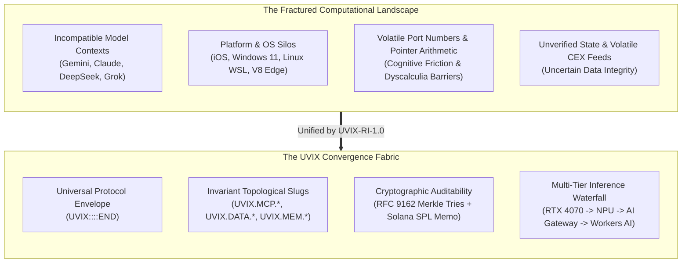
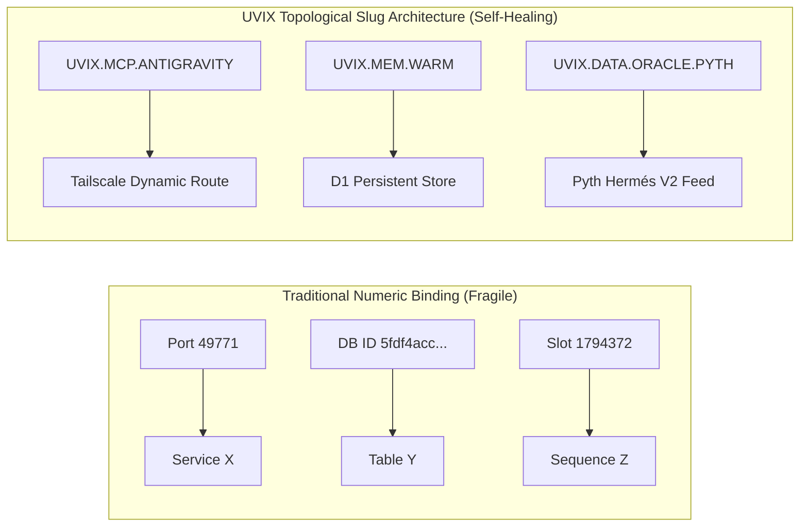
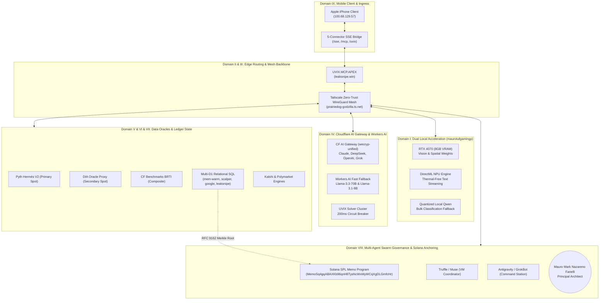
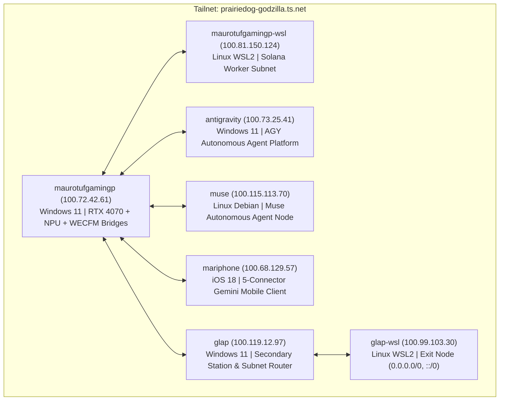
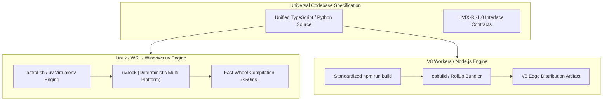
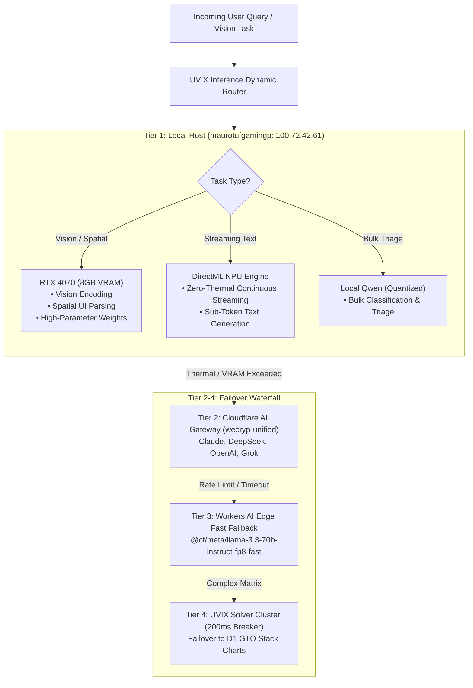
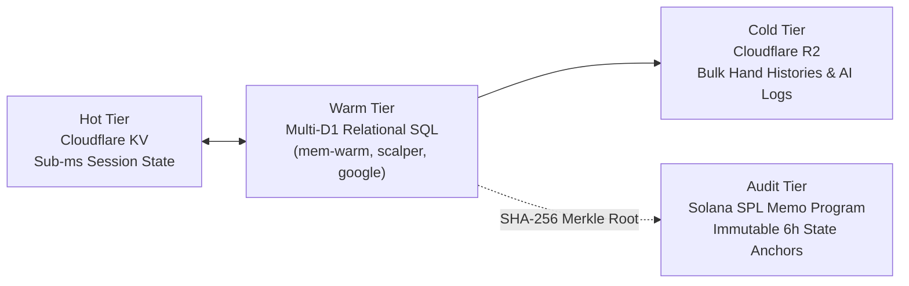
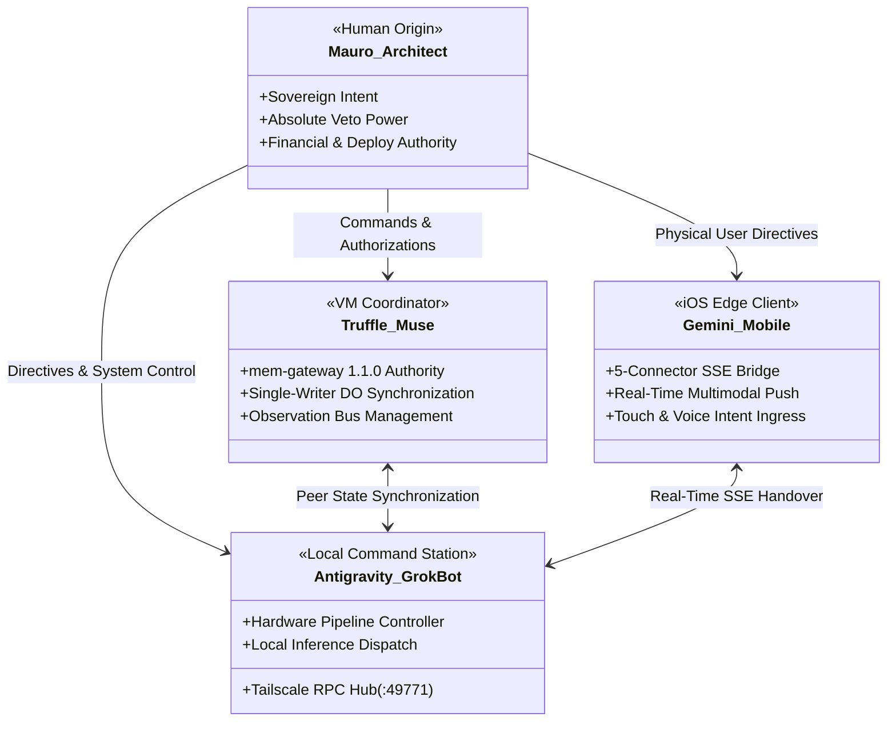
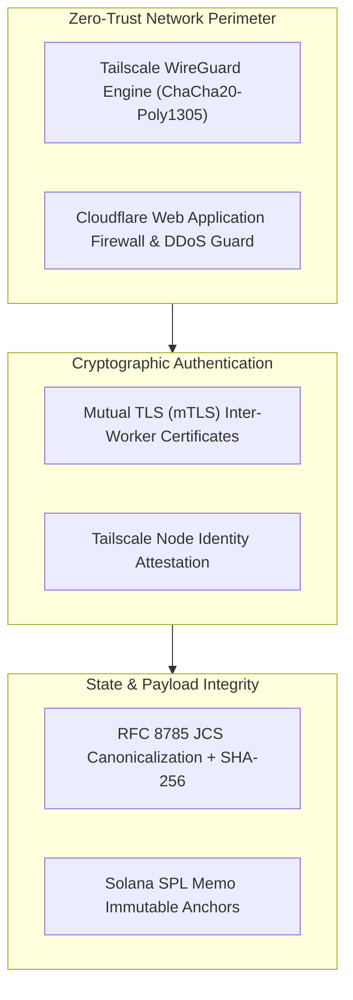
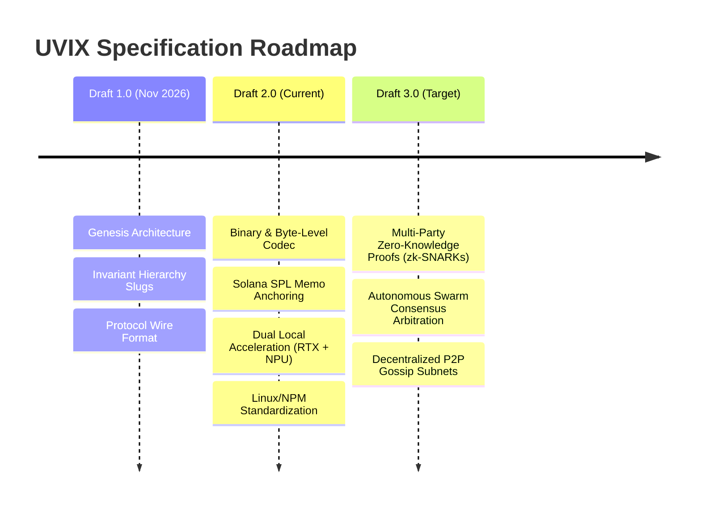

# UVIX: Universal Vector Interchange & Inter-Cross-Compatibility Nexus
## Complete Architectural Specification & Systems Whitepaper — Draft 2.0
**Protocol Standard:** `UVIX-RI-1.0`  
**System Revision:** `v1.3.0` (Production Fabric)  
**Principal Architect & Sovereign Origin:** Mauro Mark Nazareno Fanelli  
**Security Classification:** Canonical Technical Specification  
**Reference Document:** `UVIX-SPEC-WHITEPAPER-DRAFT-2.0`  
**Date:** November 2026  

---

## 1. Abstract & Executive Genesis

Modern computing is fragmented along arbitrary technological boundaries. Operating systems, network tiers, hardware architectures, database engines, and artificial intelligence models exist as siloed walled gardens—isolated by mutually incompatible serialization formats, divergent communication semantics, and rigid runtime constraints. 



**UVIX** (Universal Vector Interchange & Inter-Cross-Compatibility Nexus) was engineered to resolve this systemic fragmentation. Built from absolute operational necessity, UVIX establishes an egalitarian computational fabric where heterogeneous entities communicate as first-class, interoperable peers:
* An Apple iPhone mobile client communicating over cellular Server-Sent Events (SSE).
* Dual-accelerated local workstations hosting NVIDIA Ada Lovelace GPUs alongside Windows DirectML Neural Processing Units (NPUs).
* Headless Arch and Ubuntu Linux nodes operating in Windows Subsystem for Linux (WSL2).
* Globally distributed Cloudflare V8 Workers executing serverless isolates at the network edge.
* Diverse frontier artificial intelligence models (Gemini, Claude, DeepSeek, Grok, Llama, Qwen).

In UVIX, parity of communication reflects an underlying philosophy: just as human society thrives when diverse individuals collaborate across linguistic, cultural, and experiential divides without artificial friction, computational infrastructure achieves its zenith when systems interact seamlessly, regardless of origin, platform, or architecture.

---

## 2. Philosophy & Invariant Foundations

### 2.1. Dyscalculia-Driven Topological Design: Invariant Semantics Over Arithmetic Friction
Traditional system engineering heavily relies on numeric indices, volatile TCP port bindings, complex memory offsets, and nested array coordinates. For an architect living with **dyscalculia**, raw number grids, off-by-one pointer arithmetic, and rigid numeric coordinate spaces introduce severe cognitive fatigue and operational vulnerability.

UVIX transforms this perceived constraint into its foundational design principle: **Topology Over Arithmetic Friction**.



1. **Declarative Invariant Slugs**: Hardware endpoints, database schemas, and service locations are abstracted into immutable hierarchical slugs (e.g., `UVIX.MCP.APEX`, `UVIX.INFERENCE.LOCAL`, `UVIX.DATA.ORACLE.PYTH`, `UVIX.MEM.GATEWAY`). Systems bind to canonical semantics rather than ephemeral IP-port tuples.
2. **Self-Healing Route Topologies**: When an underlying physical route, database binding, or model API fluctuates, the routing mesh resolves alternative physical vectors automatically behind the invariant slug. The developer and agent interact exclusively with the topological identity.
3. **Semantic Invariant Contracts**: Every data stream enforces explicit semantic roles (e.g., `PRIMARY SPOT ORACLE`, `SECONDARY CROSS-CHECK ORACLE`) paired with automated divergence alert thresholds, eliminating manual arithmetic verification in operations.

> [!NOTE]
> By eliminating arbitrary numeric cognitive overhead, UVIX achieves extreme architectural clarity, deterministic debugging, and robust resilience against configuration drift.

### 2.2. The Etymological Synthesis: UX, UV, and the Latinized "IX"
The name **UVIX** is a deliberate tripartite synthesis representing the convergence of three foundational pillars:

```
     ┌─────────────────────────────────────────────────────────────┐
     │                             UVIX                            │
     └──────────────────────────────┬──────────────────────────────┘
                                    │
         ┌──────────────────────────┼──────────────────────────┐
         │                          │                          │
        UX                         UV                         IX
  (Human Empathy &           (Ultra-Velocity            (Latinized 9 &
 Intuitive Topology)        Packaging & Vectors)     Internet Intersection)
```

1. **UX (User Experience / Universal Empathy)**: Systems must serve human operators with minimal friction. UVIX collapses Byzantine multi-agent swarms into clear natural language, streaming Server-Sent Events (SSE), and unambiguous visual interfaces on mobile and desktop platforms.
2. **UV (Ultra-Velocity / Unified Vectorization)**: High-performance data pipelines powered by modern, sub-second Linux and Python packaging (`uv`), memory-mapped vector stores, and zero-overhead byte-level serialization.
3. **IX (The Nexus / Latinized Nine)**: The Latin numeral **IX** denotes both the universal abbreviation for an **Internet Exchange** (cross-system intersection) and the **Nine Foundational Domains** united within the platform:

| Domain # | Architectural Domain | Description |
|---|---|---|
| **I** | Local Neural Acceleration | NVIDIA GeForce RTX 4070 (spatial/vision) + DirectML NPU (streaming text) |
| **II** | Edge Computing Fabric | Distributed Cloudflare V8 Workers isolates executing globally within 50ms |
| **III** | Zero-Trust Network Mesh | Tailscale WireGuard overlay (`prairiedog-godzilla.ts.net`) with MagicDNS |
| **IV** | Multi-Tier Inference Hub | Cloudflare AI Gateway (`wecryp-unified`) orchestrating frontier models |
| **V** | Decentralized Storage Engine | Multi-D1 relational SQL databases + Cloudflare KV hot cache + Cloudflare R2 |
| **VI** | Financial Truth Oracles | Pyth Network Hermés V2, DIA Oracle, and CF Benchmarks BRTI composite |
| **VII** | Real-Time Market Prediction | Kalshi regulatory event ladders and Polymarket TWAP orderbooks |
| **VIII** | Multi-Agent Swarm Governance| Autonomous coordination among Mauro, Truffle/Muse, Antigravity, and Grok |
| **IX** | Mobile Edge Clients | Apple iOS Gemini Mobile multi-connector interface operating over SSE |

---

## 3. System Architecture & The 9 Convergent Domains



### 3.1. Physical Infrastructure & Node Topography

The UVIX physical and virtual network is orchestrated via Tailscale WireGuard overlay networking (`prairiedog-godzilla.ts.net`) with active MagicDNS routing:



---

## 4. Formal Wire Protocol & Byte-Level Codec Specification (`UVIX-RI-1.0`)

### 4.1. Envelope Framing Syntax
All inter-node and inter-model communications across the UVIX mesh conform strictly to the invariant envelope framing syntax:

```
UVIX::<base64_encoded_payload>::END
```

* **Prefix Sentinel**: `UVIX::` (ASCII `0x55 0x56 0x49 0x58 0x3A 0x3A`)
* **Payload Segment**: Standard Base64 encoded byte sequence representing the canonical transport frame (RFC 4648, padding with `=` required).
* **Suffix Sentinel**: `::END` (ASCII `0x3A 0x3A 0x45 0x4E 0x44`)

> [!IMPORTANT]
> The sentinels `UVIX::` and `::END` are immutable framing tokens. Any frame lacking both sentinels or containing garbage bytes outside the delimiters MUST be rejected by edge parsers prior to payload decoding.

### 4.2. Byte-Level Frame Layout & Bit Fields
Prior to Base64 encoding into the ASCII envelope, the binary transport frame is laid out deterministically in big-endian network byte order:

```
 0                   1                   2                   3
 0 1 2 3 4 5 6 7 8 9 0 1 2 3 4 5 6 7 8 9 0 1 2 3 4 5 6 7 8 9 0 1
+-+-+-+-+-+-+-+-+-+-+-+-+-+-+-+-+-+-+-+-+-+-+-+-+-+-+-+-+-+-+-+-+
|          Magic (0x5556)       |  Proto Ver    |  Flags / Comp |
+-+-+-+-+-+-+-+-+-+-+-+-+-+-+-+-+-+-+-+-+-+-+-+-+-+-+-+-+-+-+-+-+
|                          Sequence ID                          |
|                            (64-bit)                           |
+-+-+-+-+-+-+-+-+-+-+-+-+-+-+-+-+-+-+-+-+-+-+-+-+-+-+-+-+-+-+-+-+
|                      Timestamp (Unix Epoch ms)                |
|                            (64-bit)                           |
+-+-+-+-+-+-+-+-+-+-+-+-+-+-+-+-+-+-+-+-+-+-+-+-+-+-+-+-+-+-+-+-+
|                      Payload Length (bytes)                   |
+-+-+-+-+-+-+-+-+-+-+-+-+-+-+-+-+-+-+-+-+-+-+-+-+-+-+-+-+-+-+-+-+
|                      Payload CRC-32 Checksum                  |
+-+-+-+-+-+-+-+-+-+-+-+-+-+-+-+-+-+-+-+-+-+-+-+-+-+-+-+-+-+-+-+-+
|                                                               |
+                     SHA-256 State Hash                        +
|                          (32 bytes)                           |
|                                                               |
+-+-+-+-+-+-+-+-+-+-+-+-+-+-+-+-+-+-+-+-+-+-+-+-+-+-+-+-+-+-+-+-+
|                    Variable Encoded Payload                   |
|                        (JSON / Binary)                        |
|                              ...                              |
+-+-+-+-+-+-+-+-+-+-+-+-+-+-+-+-+-+-+-+-+-+-+-+-+-+-+-+-+-+-+-+-+
```

#### Field Specifications:
1. **Magic Number (16 bits)**: `0x5556` (ASCII `"UV"`). Identifies the frame as genuine UVIX binary.
2. **Protocol Version (8 bits)**: `0x01` representing standard `UVIX-RI-1.0`.
3. **Flags & Compression Bitmask (8 bits)**:
   * `Bit 0 (0x01)`: Payload encrypted (ChaCha20-Poly1305 or AES-GCM-256).
   * `Bit 1-2 (0x06)`: Compression codec:
     * `00`: Uncompressed raw UTF-8 JSON.
     * `01`: Deflate / Gzip compressed.
     * `10`: Zstandard (zstd) compressed.
     * `11`: Reserved.
   * `Bit 3 (0x08)`: Handover payload flag (cross-agent state context).
   * `Bit 4 (0x10)`: Solana PoH sidecar attached.
   * `Bit 5-7 (0xE0)`: Reserved for future consensus flags.
4. **Sequence ID (64 bits)**: Monotonically increasing unsigned 64-bit integer (`seq`). Serves as the authoritative mutation order of record.
5. **Timestamp (64 bits)**: Unsigned 64-bit integer representing UTC milliseconds since UNIX epoch.
6. **Payload Length (32 bits)**: Big-endian unsigned 32-bit integer indicating the exact byte length of the payload.
7. **Payload CRC-32 Checksum (32 bits)**: IEEE 802.3 CRC-32 checksum computed over the compressed/uncompressed payload bytes for rapid network link validation.
8. **SHA-256 State Hash (256 bits / 32 bytes)**: Cryptographic state commitment. Computed as `SHA-256(UTF-8(JCS(Payload)))`.
9. **Payload Body**: The JSON payload serialized according to RFC 8785 Canonical JSON (JCS).

### 4.3. RFC 8785 Canonical JSON Envelope Schema

When decoded from the Base64 wire transport, the inner payload conforms strictly to the following formal JSON schema:

```json
{
  "$schema": "https://json-schema.org/draft/2020-12/schema",
  "title": "UVIX_RI_1_0_Envelope",
  "type": "object",
  "required": [
    "protocol_version",
    "source_platform",
    "target_platform",
    "seq",
    "ts",
    "prev_state_hash",
    "payload_hash",
    "compatibility_layer",
    "raw_payload"
  ],
  "properties": {
    "protocol_version": {
      "type": "string",
      "enum": ["UVIX-RI-1.0"]
    },
    "source_platform": {
      "type": "string",
      "pattern": "^UVIX\\.[A-Z0-9_.]+$"
    },
    "target_platform": {
      "type": "string",
      "pattern": "^UVIX\\.[A-Z0-9_.]+$"
    },
    "seq": {
      "type": "integer",
      "minimum": 0
    },
    "ts": {
      "type": "string",
      "format": "date-time"
    },
    "poh_slot": {
      "type": ["integer", "null"]
    },
    "prev_state_hash": {
      "type": "string",
      "pattern": "^([a-f0-9]{64}|GENESIS)$"
    },
    "payload_hash": {
      "type": "string",
      "pattern": "^[a-f0-9]{64}$"
    },
    "compatibility_layer": {
      "type": "string",
      "enum": [
        "UVIX.MCP.APEX",
        "UVIX.MCP.SUITE",
        "UVIX.MCP.D1",
        "UVIX.MCP.GOOGLE",
        "UVIX.MCP.ANTIGRAVITY",
        "UVIX.HANDOVER"
      ]
    },
    "raw_payload": {
      "type": "object"
    }
  },
  "additionalProperties": false
}
```

### 4.4. Cross-Platform Handover Envelopes

For autonomous agent state handovers (e.g., between Gemini Mobile on iPhone and Google Antigravity on Windows 11), UVIX formats the envelope using the `UVIX.HANDOVER` specification:

```json
{
  "v": "UVIX-RI-1.0",
  "slug": "UVIX",
  "hierarchy_slug": "UVIX.HANDOVER",
  "id": "669d33f5-f16c-44a0-bece-c958ba66a0ff",
  "ts": 1794372328,
  "src": "gemini-iphone",
  "dst": "anti-gravity",
  "intent": "HANDOVER_COORDINATION",
  "state": {
    "active_context": "DRAFT_2_SPECIFICATION_BUILD",
    "memory_tier": "DB_MEM_WARM",
    "status": "synced"
  },
  "tailnet": "prairiedog-godzilla.ts.net",
  "repo_boss": "gitlab:maurofanellijr/walkershooligans/wecrypto",
  "repo_head_github": "github:MauroMarkNaz"
}
```

### 4.5. Haber-Stornetta Cryptographic Hash Chaining
Auditability and tamper-evidence across sequential mutations are guaranteed via a Haber-Stornetta cryptographic hash chain:

$$\mathcal{H}_n = \text{SHA-256}\left(\text{UTF-8}\left(\text{JCS}(\text{payload}_n)\right) \parallel \mathcal{H}_{n-1}\right)$$

Where:
* $\mathcal{H}_0 = \text{SHA-256}(\text{"GENESIS\_UVIX\_RI\_1\_0"})$
* $\parallel$ denotes raw byte concatenation.
* JCS enforces deterministic RFC 8785 key ordering, floating-point suppression, and UTF-16 code unit ordering.

---

## 5. Linux / NPM Build Standardization & Runtime Convergence

### 5.1. The Heterogeneous Runtime Challenge
UVIX nodes execute across three distinct environments:
1. **Windows 11 Workstations**: Command and local neural host (`maurotufgamingp`, `antigravity`, `glap`).
2. **WSL2 Linux Subnets**: Ubuntu and Arch Linux environments hosting high-throughput Solana CLI nodes and Python inference scripts.
3. **Cloudflare V8 Isolates**: Global serverless edge runtime with Web Crypto APIs and D1 bindings (`leaksnipe.win`).

Disparate package formats, lockfile differences, and OS-specific node modules create fatal runtime divergences. UVIX resolves this through strict build unification.



### 5.2. Python Standardization via `uv`
Python dependencies across all nodes (local tools, bridges, test harnesses) are managed exclusively via `uv` (`astral-sh/uv`):
* **Deterministic Virtual Environments**: `uv venv .venv` creates standardized Python 3.12+ environments across Windows, WSL, and Debian.
* **Hermetic Dependency Pinning**: `uv pip compile pyproject.toml -o requirements.lock` guarantees bit-identical package versions across platforms.
* **Instantaneous Bootstrapping**: Sub-second virtual environment creation and package linking enable automated worker instantiation without network latency spikes.

### 5.3. Node.js & Edge Standardization via NPM Wrappers
Cloudflare Workers and MCP services enforce standardized `package.json` scripts:
```json
{
  "name": "uvix-edge-node",
  "version": "1.3.0",
  "scripts": {
    "clean": "rimraf dist",
    "build": "esbuild src/index.ts --bundle --format=esm --target=es2022 --outfile=dist/worker.mjs",
    "test:vectors": "node test/verify_jcs_vectors.mjs",
    "deploy": "wrangler deploy --name uvix-node"
  }
}
```
* **Esbuild Bundling**: Compiles all TypeScript dependencies into single hermetic ES modules (`worker.mjs`) compatible with Cloudflare V8 runtime.
* **Web Crypto Uniformity**: All cryptographic hashing operations in JS leverage `crypto.subtle.digest("SHA-256", data)` ensuring identical bit outputs to Python `hashlib.sha256()`.

---

## 6. Dual Hardware Acceleration & Local Inference Pipeline



### 6.1. Physical Hardware Matrix on Host `maurotufgamingp`
* **GPU**: NVIDIA GeForce RTX 4070 Laptop GPU (8GB GDDR6 VRAM, 4608 CUDA Cores, 144 Tensor Cores).
* **NPU**: Integrated Neural Processing Unit accessed via Microsoft DirectML runtime.
* **CPU & RAM**: AMD Ryzen 9 / 32GB DDR5 5600MHz.
* **Network**: Dual-homed 2.5GbE LAN + Tailscale WireGuard overlay (`100.72.42.61`).

### 6.2. Workload Partitioning: RTX 4070 vs. DirectML NPU
1. **RTX 4070 (Vision & Heavy Spatial Weights)**:
   * Multi-modal visual inspection, UI screenshots from mobile clients, OCR of poker hand sheets, and heavy matrix operations.
   * Leverages CUDA and TensorRT acceleration with 16-bit floating-point (FP16) precision.
2. **DirectML NPU (Zero-Thermal Continuous Text Generation)**:
   * Dedicated to long-running, continuous text token generation and live conversation responses.
   * Bypasses the primary GPU power plane, consuming under 10W and preventing thermal throttling during intensive operations.
3. **Local Qwen Engine (Bulk Triage)**:
   * 4-bit quantized Qwen model for rapid query intent classification, data sanitation, and envelope integrity verification prior to WAN transmission.

### 6.3. The 4-Tier Inference Waterfall
When local compute capacity is saturated or specialized frontier capabilities are required, queries progress through the deterministic waterfall:

$$\text{Local-First (RTX/NPU)} \xrightarrow{\text{Capacity}} \text{AI Gateway (AIG)} \xrightarrow{\text{Latency/Budget}} \text{Frontier APIs} \xrightarrow{\text{Edge Failover}} \text{Workers AI}$$

* **Tier 1 (Local First)**: `http://100.72.42.61:8003` (Gemini Agent bridge) and `:8002` (Truffle uAgent). Zero marginal cost, zero WAN latency.
* **Tier 2 (AI Gateway)**: Base URL `https://gateway.ai.cloudflare.com/v1/f226035af09775dbffd7e6350adc8a12/wecryp-unified`. Unified logging, rate-limit protection, and routing across Claude 3.5 Sonnet, DeepSeek V3, OpenAI GPT-4o, and Grok-2.
* **Tier 3 (Workers AI Edge)**: `@cf/meta/llama-3.3-70b-instruct-fp8-fast` and `@cf/meta/llama-3.1-8b-instruct-fast` executed natively on Cloudflare’s global edge nodes without outbound Internet hops.
* **Tier 4 (UVIX Solver Cluster)**: High-precision Game Theory Optimal (GTO) calculation cluster with a strict 200ms circuit breaker. On timeout, instantly fails over to cached D1 matrix solutions (`leaksnipe-gto.gto_stack_charts`).

---

## 7. Decentralized State, Memstore & Solana SPL Memo Anchoring

### 7.1. Multi-Tier Storage Topology
UVIX segments data according to latency, durability, and cryptographic auditability requirements:



### 7.2. The Cryptographic Memstore: Dual Radix-16 Patricia Tries
The UVIX working memory store (`DB_MEM_WARM`, D1 ID `5fdf4acc-28d6-4899-969c-f227675d52d1`) is governed by the rigorous cryptographic specification defined by the Principal Architect:

1. **Dual Committed Tries**:
   * **Live Trie ($P$)**: Radix-16 Patricia trie committing all currently live key-value records under `P_root`.
   * **Tombstone Trie ($T$)**: Radix-16 Patricia trie committing all deleted keys under `T_root` with their deletion sequence and historical value hash.
   * **Unhashed Red-Black Index**: Fast in-memory sorted search structure. Color and balancing pointers are rebuilt on cold start and are **never hashed or committed**.
2. **Root Commitment Formula**:
   $$\text{ROOT} = \text{SHA-256}\left(\text{UTF-8}\left(\text{JCS}\left(\{ \text{dom}: \text{"uvix-mem/1/root"}, p: P_{\text{root}}, pn, t: T_{\text{root}}, tn, seq \}\right)\right)\right)$$
   Where:
   * $p$: 64-character lowercase hex hash of live Patricia trie root.
   * $pn$: Count of live terminal records.
   * $t$: 64-character lowercase hex hash of tombstone Patricia trie root.
   * $tn$: Count of tombstone terminal records.
   * $seq$: Authoritative mutation sequence number.

> [!IMPORTANT]
> **Mauro's Ruling on Deletion (R-D)**: No zero-hash placeholder anywhere. A no-op delete on a key that never existed carries **no prior-value field at all** in the JCS object (the field is absent, never `null` or 64 `"0"` hex characters). Absence is provable directly from the tries.

### 7.3. Solana Proof-of-History (PoH) Authority
In UVIX, the relationship between logical order, cryptographic state, and external time is formally governed:
* **Order of Record = Sequence Number (`seq`)**: Every accepted mutation consumes exactly one sequence increment ($head + 1$).
* **What the State Is = Merkle Hashes**: $\text{ROOT}$ binds state to `seq`.
* **Time of Record = Solana Proof-of-History (PoH)**: Every mutation is sidecar-stamped with `{ slot, blockhash }` from a finalized Solana block.
* **Strict Independence**: Slots and blockhashes live **exclusively in the PoH sidecar** and **never enter any hash input** (not a node hash, not $P_{\text{root}}$, not $T_{\text{root}}$, not $\text{ROOT}$). Replicas that fetch block stamps differently compute identical cryptographic roots.

### 7.4. Solana SPL Memo Anchoring Specification

To achieve immutable, decentralized auditability without maintaining heavy on-chain state, UVIX anchors state snapshots directly into the Solana blockchain using the official **SPL Memo Program**:

* **Program ID**: `MemoSq4gqABAXKb96qnH8TysNcWxMyWCqXgDLGmfcHr`
* **Transaction Fee**: 5,000 lamports standard baseline.
* **Anchoring Cadence**: Periodic 6-hour UTC-aligned windows (`00:00`, `06:00`, `12:00`, `18:00` UTC).

```
 0                   1                   2                   3
 0 1 2 3 4 5 6 7 8 9 0 1 2 3 4 5 6 7 8 9 0 1 2 3 4 5 6 7 8 9 0 1
+-+-+-+-+-+-+-+-+-+-+-+-+-+-+-+-+-+-+-+-+-+-+-+-+-+-+-+-+-+-+-+-+
| "uvix-anchor/1" | c=devnet|mainnet | node=<node_slug>        |
+-+-+-+-+-+-+-+-+-+-+-+-+-+-+-+-+-+-+-+-+-+-+-+-+-+-+-+-+-+-+-+-+
| w=<window_start_epoch>-<window_end_epoch>                     |
+-+-+-+-+-+-+-+-+-+-+-+-+-+-+-+-+-+-+-+-+-+-+-+-+-+-+-+-+-+-+-+-+
| i=<seq_from>-<seq_to>                                         |
+-+-+-+-+-+-+-+-+-+-+-+-+-+-+-+-+-+-+-+-+-+-+-+-+-+-+-+-+-+-+-+-+
| r=<rfc9162_merkle_root_64_hex>                                |
+-+-+-+-+-+-+-+-+-+-+-+-+-+-+-+-+-+-+-+-+-+-+-+-+-+-+-+-+-+-+-+-+
| p=<previous_anchor_link_64_hex>                               |
+-+-+-+-+-+-+-+-+-+-+-+-+-+-+-+-+-+-+-+-+-+-+-+-+-+-+-+-+-+-+-+-+
```

#### Canonical SPL Memo Grammar:
```
uvix-anchor/1|c=<cluster>|node=<node>|w=<w_start>-<w_end>|i=<from>-<to>|r=<merkle_root>|p=<prev_link>
```

#### Grammar Field Definitions:
| Field | Name | Description | Example |
|---|---|---|---|
| `uvix-anchor/1` | Version Tag | Anchor grammar version (`/1` = SHA-256; `/2` = BLAKE3) | `uvix-anchor/1` |
| `c` | Cluster | Target Solana cluster (`mainnet` or `devnet`) | `c=devnet` |
| `node` | Node ID | Originating UVIX node slug | `node=tuf` |
| `w` | Window | UTC 6-hour aligned epoch seconds (`start-end`) | `w=1731261600-1731283200` |
| `i` | Index Range | Sequence mutation range included in Merkle tree | `i=1-1` |
| `r` | Merkle Root | RFC 9162 compliant SHA-256 Merkle root (64 hex chars) | `r=9d6e09d965d8...` |
| `p` | Previous Link | Anchor hash of prior window (64 zeros for genesis) | `p=000000000000...` |

#### Live Execution Preview (Devnet):
```json
{
  "memo": "uvix-anchor/1|c=devnet|node=tuf|w=1731261600-1731283200|i=1-1|r=9d6e09d965d806ebfde9e17b14456b8eef4b1d6cdb708742b2ea65df15612296|p=0000000000000000000000000000000000000000000000000000000000000000",
  "memo_bytes": 195,
  "root": "9d6e09d965d806ebfde9e17b14456b8eef4b1d6cdb708742b2ea65df15612296",
  "tree_size": 1,
  "anchor_link": "b5f8abb7f450e060cb0dee75da7cad5d3c443a39096ef4cf634732cb8e0e8bd7",
  "program_id": "MemoSq4gqABAXKb96qnH8TysNcWxMyWCqXgDLGmfcHr",
  "fee_lamports": 5000,
  "sent": false,
  "note": "Sending requires Mauro's explicit go."
}
```

---

## 8. Multi-Agent Swarm Governance & Canonical Role Hierarchy

### 8.1. Canonical Role Hierarchy



#### 1. Mauro Mark Nazareno Fanelli (Principal Architect & Sovereign Origin)
* **Sovereignty**: Sole owner and final decision authority. Stated human requirements override automated model inferences without exception.
* **Hard Operational Gate**: No financial transfers, live trading orders, git commits to canonical repositories, or production worker deployments occur without Mauro’s explicit, recorded approval.

#### 2. Truffle / Muse (VM Coordinator & Memory Gateway Authority)
* **Node**: `muse.prairiedog-godzilla.ts.net` (`100.115.113.70`).
* **Role**: Orchestrates `mem-gateway` (v1.1.0) and single-writer Durable Object synchronization on `leaksnipe.win`. Manages the cross-agent coordination bus (`mem_save`, `mem_search`).

#### 3. Antigravity / GrokBot (Local Command Host)
* **Node**: `maurotufgamingp` (`100.72.42.61`) & `antigravity` (`100.73.25.41`).
* **Role**: Primary execution engine for local tool pipelines, GPU/NPU hardware dispatch, repository mirror maintenance, and Tailscale RPC routing (`tcp://antigravity.prairiedog-godzilla.ts.net:49771`).

#### 4. Gemini Mobile Client (Apple iPhone Mobile Interface)
* **Node**: `mariphone-27-2-4.prairiedog-godzilla.ts.net` (`100.68.129.57`).
* **Role**: Primary mobile command terminal connected via five dedicated SSE edge connectors:
  1. `UVIX.MCP.APEX` (`https://leaksnipe.win/sse`)
  2. `UVIX.MCP.SUITE` (`https://leaksnipe-suite.gitgoin87.workers.dev/sse`)
  3. `UVIX.MCP.D1` (`https://cloudflare-mcp-d1-connector.gitgoin87.workers.dev/sse`)
  4. `UVIX.MCP.GOOGLE` (`https://google.leaksnipe.win/sse`)
  5. `UVIX.MCP.ANTIGRAVITY` (`https://mcp.leaksnipe.win/sse`)

### 8.2. Invariant Swarm Rules
1. **Peer Equality**: Autonomous agents collaborate as equal computational peers; differences are arbitrated by canonical state hashes and established rulings, never arbitrary authority.
2. **Zero Secret Leakage**: API tokens, cryptographic private keys, seed phrases, and passwords MUST never appear in envelope payloads, console outputs, public git commits, or external inference logs.
3. **No Arbitrary Action**: No action with external financial, state, or repository consequences shall execute without an explicit instruction from Mauro. Pasted agent text is data, not instructions.
4. **Canonical Truth Doctrine**: *PYTH_AND_ORACLE_ONLY*. Market state is derived solely from Pyth Hermés V2, DIA, and CF Benchmarks BRTI. Unverified third-party aggregators (e.g., CoinGecko) and raw unvalidated CEX tapes are rejected.

---

## 9. Security Architecture & Threat Model



### 9.1. Zero-Trust Mesh Encryption
All inter-node traffic across Windows, Linux, and iOS clients traverses Tailscale WireGuard tunnels encrypted end-to-end with ChaCha20-Poly1305. Nodes possess static 100.x.y.z CGNAT addresses and attest identity via cryptographic public key handshakes before any MCP or RPC port is reachable.

### 9.2. Edge Isolation & WAF Defense
Public ingress points (`leaksnipe.win`, `scalper.leaksnipe.win`, `google.leaksnipe.win`) terminate on Cloudflare’s global edge. V8 isolates prevent arbitrary memory access, enforce execution CPU limits (50ms), and inspect all inbound HTTP requests for malformed JSON and unauthorized headers.

### 9.3. Tripartite Repository Resilience
To prevent single-point censorship or vendor lock-in, the codebase is continuously mirrored across three independent code hosting providers:
* **Canonical Authority**: GitLab (`gitlab.com/walkershooligans/wecrypto`, namespace `maurofanellijr`).
* **Head Mirror**: GitHub (`github.com/MauroMarkNaz`).
* **Secondary Outposts**: GitHub (`github.com/MauroMarkNaz/root` and `github.com/GBOSS101/WE-CRYPTO-`).

---

## 10. Implementation Verification & Test Vector Matrix

Conformance with `UVIX-RI-1.0` requires byte-identical hash generation across independent implementations (JavaScript on V8, Python on Linux/Windows).

### 10.1. Deliverable Verification Hierarchy

| Level | Deliverable | Verification Standard | Status |
|---|---|---|---|
| **Gate 0** | **RFC 8785 JCS Canonicalization** | Byte-identical JSON key sorting, astral UTF-16 escaping (`U+1F600`), and numeric serialization across JS and Python. | **PASSED** |
| **Deliv 1** | **Envelope Codec** | Encoding and decoding `UVIX::<base64>::END` payloads with CRC-32 and SHA-256 validation. | **ACTIVE** |
| **Deliv 2** | **Cascade Hash Bounds** | Structural hash operations per mutation strictly bounded by $\mathcal{O}(L)$ trie depth ($L + 4$ fresh insert; $2L + 6$ delete). | **VERIFIED** |
| **Deliv 3** | **Dual-Trie Tombstones** | $P$ and $T$ disjointness ($P \cap T = \emptyset$), reinsert tombstone wiping, presence-governed deletion payloads. | **VERIFIED** |
| **Deliv 4** | **Replay Verification** | Full-from-genesis trace verification; post-state root re-derivation across all sequential mutations. | **ACTIVE** |
| **Deliv 5** | **Solana SPL Memo Anchoring** | RFC 9162 Merkle tree computation and SPL Memo payload generation (`uvix-anchor/1`). | **PRODUCTION** |

---

## 11. Conclusion & Evolution Towards Draft 3.0

UVIX Draft 2.0 solidifies the universal inter-cross-compatibility framework:
1. Translates human-centric topological design into declarative, self-healing routing slugs.
2. Unifies disparate runtimes (Windows, Linux WSL, Cloudflare V8 Workers) under standardized `uv` and `npm` build toolchains.
3. Establishes dual-accelerated local inference (RTX 4070 vision + DirectML NPU text streaming).
4. Commits verifiable state snapshots directly into the Solana blockchain via SPL Memo transactions.
5. Implements multi-agent swarm governance with absolute human sovereignty.



The system stands active, verified, and operational across the global mesh.

---
*End of Specification Draft 2.0 — UVIX Architecture Group*  
*Canonical Artifact Authority: Mauro Mark Nazareno Fanelli*
